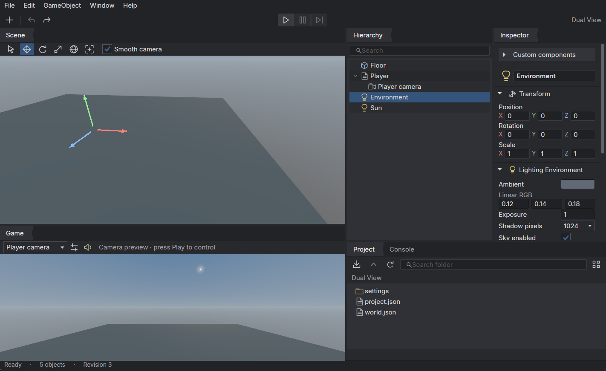
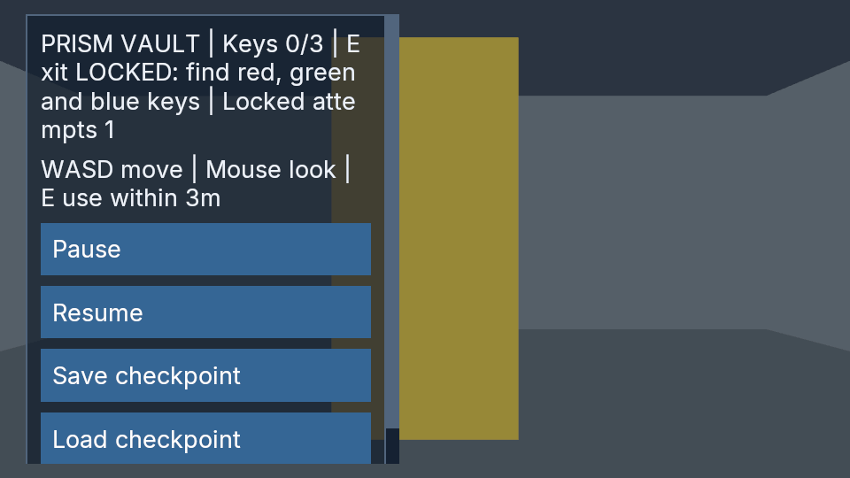
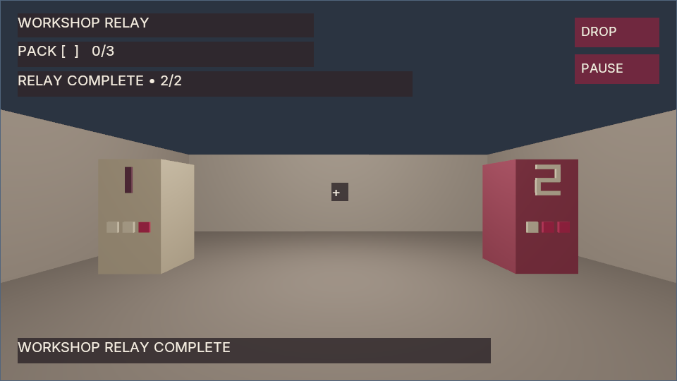

# Poima Engine

**An agent-native game engine, built for people and the agents they work with.**

Poima is an open-source 3D engine with a native **C++20** core, **Vulkan** graphics and **C#** gameplay. Its CLI and desktop editor share an authoritative engine service: an agent can inspect, edit, run and observe a world through structured commands, while you work in the editor.

[Get started](#get-started) · [Try a sample](examples/collection-game) · [Documentation](#documentation) · [Road to 1.0](docs/ROADMAP.md) · [Implementation status](docs/IMPLEMENTATION_STATUS.md) · [Changelog](CHANGELOG.md)



*Desktop editor with independent Scene and Game views.*

> **0.0.153.** See the [implementation status](docs/IMPLEMENTATION_STATUS.md) for tested workflows and known limits.

## Built for iteration

Poima makes engine operations directly available to tools. External agents such as Codex and Claude can use the CLI or newline-delimited JSON-RPC without opening an editor or relying on screen coordinates.

- **Discover and inspect.** Fetch available operations or a focused mutation schema, and inspect the current world before making changes. Find the entity/template fields using an asset through [reference queries](docs/ASSET_REFERENCES.md).
- **Edit together.** Humans and agents use shared sessions. Atomic transactions apply related edits together; revision guards reject stale changes, and retry receipts prevent duplicate application.
- **Build deliberately.** Submit [native publish/export jobs](docs/DEVELOPMENT_PROFILES.md) using host-selected toolchains, inspect verified artifact identities, [adopt compiled gameplay into a project](docs/PROJECT_GAMEPLAY_ADOPTION.md) with hash guards and durable retries, then export. Build submission has separate MCP consent.
- **Run and observe.** Exercise gameplay with scripted input, [inspect readiness, pause and capture a live native game](docs/LIVE_PLAYER.md) through a shared headless host, inspect simulation state and profiling data, and read [displayed UI bounds and clipping](docs/PLAYER_UI_OBSERVATION.md).
- **Recover and repeat.** Bounded authoring undo/redo, runtime rollback and input replay support reproducible checks within their documented contracts.

The desktop editor is a visual client of the same engine, with a hierarchy, typed Inspector, Project browser, transform gizmos and separate Scene and Game panels. Gameplay uses C#, including compatible development reload and Native AOT bundle workflows. Optional [owned Windows compiler sessions](docs/DEVELOPMENT_JOBS.md#optional-owned-windows-compiler) reuse a private compiler across MSBuild jobs and expose actual-use evidence.

Explicit [live material editing](docs/LIVE_MATERIALS.md) applies authored color, emission, metallic and roughness changes while the game continues. [Live texture editing](docs/LIVE_TEXTURES.md) also adopts all five PBR maps, sampler settings and map strengths while preserving gameplay and save state. Separate acceptance, submission and presentation receipts let tools check which snapshot reached rendering.

Three game families now have qualifying fresh agent workflows, with independent gameplay, saved-state continuation and relocated Windows export checks:

| Game | Agent | What it exercises |
| --- | --- | --- |
| [Switchback Range](docs/evidence/fixtures/agent-switchback-fresh/README.md) | Codex | First-person movement, imported animation, aiming, damage, death/retry and checkpoints. [Second fresh run](docs/evidence/m2-agent-switchback-fresh-repeat.json). |
| [Pump House](docs/evidence/fixtures/agent-pumphouse/README.md) | Claude | Inventory, interactions, persistent repair mechanisms and cold checkpoint continuation. |
| [Beacon Foundry](docs/evidence/fixtures/agent-beacon-foundry/README.md) | Codex | A bounded native work queue, real entity spawning and progress retained through an explicit save-schema upgrade. |

Each has rendered observations with its declared original project paths unavailable. These are small demonstrations under documented SDK/toolchain contexts, not a controlled agent success-rate experiment or an Alpha release. Earlier failed attempts remain recorded. Switchback's published source also [rebuilds independently](docs/evidence/m2-agent-switchback-fresh-rebuild.json); Beacon's minimal public source record has a separate, unqualified rebuild boundary. The [Alpha roadmap](docs/ALPHA_ROADMAP.md) tracks the remaining performance, content, interaction and delivery gates.

Earlier exercises include an [escape room](docs/evidence/fixtures/agent-escape/README.md), [wave defense](docs/evidence/fixtures/agent-defense/README.md), [Workshop Relay](docs/evidence/fixtures/agent-workshop/README.md) and [DEPOT RUN](docs/evidence/fixtures/agent-depot/README.md). The [original](docs/evidence/fixtures/agent-switchback/README.md) and [additional](docs/evidence/fixtures/agent-switchback-repeat/README.md) Switchback records distinguish independent game passes from failed original automation workflows.



*Three captured gameplay checkpoints, shown as a slideshow; not a live authoring session or real-time video.*



*Agent-authored Workshop Relay, captured through Vulkan after completion. Primitive geometry; this is a rendered checkpoint, not a live authoring video.*

The [authoring-core v1 contract](docs/AUTHORING_API_COMPATIBILITY.md) stabilizes nine selected world/entity methods and Transform edits. [Runtime game-session v1](docs/RUNTIME_GAME_SESSION_V1.md) adds a separate 19-method boundary for running games: typed state, spatial queries, logical controls and external saves. Both have request/result compatibility gates and native behavioral checks. The [Python client](docs/PYTHON_CLIENT.md) provides guarded authoring and opt-in frozen result validation. The [gameplay, content and save profile](docs/ALPHA_GAMEPLAY_PROFILE.md) distinguishes these selected promises from experimental APIs and native binary compatibility.

A [native reliability check](docs/evidence/m2-performance-yard-reliability.json) passes 40 checkpoint cycles, 1,801 cumulative unpaused seconds and fresh-process continuation on the retained 0.0.97 engine. A separate [0.0.106 development comparison](docs/evidence/m2-iteration-comparison.json) verifies twenty compatible edits per cohort with preserved game state and changed behavior. With the owned compiler, batching state reads lowers measured edit-to-first-verified-tick p95 from 7.732 to 3.759 seconds. Compiler reuse alone improves the mean while worsening p95 against isolated builds. The three-second target and broader Alpha gate remain open.

Joined [runtime observations](docs/RUNTIME_OBSERVATION.md) let tools inspect live poses and selected component fields together. A provider-free Workshop replay comparison uses 49% fewer native RPCs with identical checked gameplay and checkpoint state. [Reproduction and results](docs/RUNTIME_OBSERVATION.md#reproduce-the-replay-comparison).

Read the [Codex/Claude setup guide](docs/AGENT_CLIENTS.md), [agent iteration guide](docs/AGENT_ITERATION.md), [world API](docs/WORLD_SERVICE.md) and [C# gameplay guide](docs/MANAGED_GAMEPLAY.md).

## What works today

| Area | Implemented foundations |
| --- | --- |
| Graphics | Vulkan PBR, HDR composition, clustered direct lights and [authored shadow filtering](docs/SHADOWS.md#filter-selection), procedural sky, MSAA, GPU skinning, [first-person viewmodels with independent MSAA](docs/VIEWMODELS.md) and render inspection. Optional [deferred opaque lighting](docs/DEFERRED_RENDERING.md), [spatial ambient occlusion](docs/AMBIENT_OCCLUSION.md) and experimental [FSR reconstruction](docs/RECONSTRUCTION.md). |
| Gameplay | [Live world/viewmodel camera lenses](docs/CAMERA_LENSES.md) for gameplay zoom and opt-in [between-tick FOV presentation](docs/PLAYER_LENS_PRESENTATION.md), fixed-step Jolt physics, player and [compiled NPC character controls](docs/CHARACTER_INPUT.md), [native steps/slopes/platform locomotion](docs/CHARACTER_LOCOMOTION.md), [named gameplay actions](docs/INPUT_ACTIONS.md), [bone-attached hit regions](docs/HIT_REGIONS.md), [two-bone IK](docs/TWO_BONE_IK.md), [collision-aware planar root motion](docs/ROOT_MOTION.md), [static NPC pathfinding](docs/NAVIGATION.md), static triangle-mesh collision, raycasts, [complete hierarchy instances](docs/RUNTIME_INSTANCES.md) and [crossfades, inertial transitions and masked animation layers](docs/RUNTIME_ANIMATION.md). |
| Execution | Shared [native jobs](docs/JOBS.md) for parallel animation sampling, procedural material baking and opt-in [background gameplay save writes](docs/GAMEPLAY_SAVES.md), separate frame/background budgets, cancellation and actual worker-thread profiling. Physics and C# callbacks remain on the owner thread. |
| C# and persistence | Native-owned custom components, generated accessors, compatible reload, Native AOT bundles, durable save slots and corruption recovery. [Opt-in C# inertial transitions and masked layers](docs/MANAGED_GAMEPLAY.md#control-masked-layers-from-c) pass Windows/Linux CoreCLR and Native AOT fixtures while preserving older animation calls. Bounded collections and [explicit hierarchy/collection save upgrades](docs/SAVE_UPGRADES.md) preserve retained fields, instance identities and allocator history; collection resizing requires an approved plan and rejects overflow. Windows CoreCLR also supports explicitly approved new component types with defaults on retained authored entities. |
| Exported agent sessions | [Serve a verified native game](docs/GAME_SERVICE.md) through the existing CLI/MCP runtime, UI, settings, save and capture operations. Bundle content stays read-only; no editor is required. |
| Player systems | Opt-in [crouch/stand clearance](docs/CHARACTER_STANCE.md) with persistent posture, collider and camera state; guarded [live and portable player preferences](docs/PLAYER_SETTINGS.md) for FOV, pointer controls, UI scale, output gain and next-launch graphics; keyboard, mouse and gamepad profiles; [compiled settings menus](docs/COMPILED_PLAYER_SETTINGS.md) with a [tested exported-player workflow](docs/EXPORTED_PLAYER_SETTINGS.md); typed [HUD/menu layout and styling](docs/GAME_UI.md#authored-layout-and-styling), native UI controls and C# callbacks; optional Vulkan UI presentation and Steam Audio integration. |
| Content and tools | glTF/GLB and bounded [FBX model and separate-clip import](docs/FBX_IMPORT.md), [guarded source inspection and explicit retargeting](docs/ANIMATION_RETARGETING.md), PNG/JPEG and WAV import; immutable [asset records and exported credits](docs/ASSET_PROVENANCE.md); native [procedural brick/plaster materials](docs/PROCEDURAL_MATERIALS.md); optional [navigation baking, world binding and compiled queries](docs/NAVIGATION.md); project manifests, validated native bundles, CPU profiling, GPU duration samples, trace export and [bounded frame/memory capture](docs/FRAME_PERFORMANCE.md). |

These are bounded implementations, not production or game-scale performance claims. Windows graphics/editor workflows and Linux headless workflows have recorded qualification. Browser and console backends, advanced 2D, multiplayer, comprehensive water/weather, GI and production VFX tooling remain future work. Desktop layer/IK controls, automatic grounding, full-body IK, automatic anatomical/contact retargeting and general character-exporter compatibility are unfinished.

Use `poima capabilities` and `world.describe` to discover your build's interfaces. The [status document](docs/IMPLEMENTATION_STATUS.md) records feature-specific limits, platform coverage and evidence.

## Get started

### Headless core

From a Linux or WSL checkout, with CMake 3.24+, Ninja, a C++20/C99 toolchain and Python 3.9+:

```sh
cmake --preset headless
cmake --build --preset headless
ctest --preset headless
./build/headless/poima capabilities
```

This authoring build needs no GPU, display, .NET runtime or dependency downloads. Create a project in a new directory and open its world service:

```sh
./build/headless/poima project create build/FirstProject --name "First Project"
./build/headless/poima world build/FirstProject/world.json
```

Send one JSON-RPC request per line:

```json
{"jsonrpc":"2.0","id":1,"method":"world.describe","params":{"view":"catalog"}}
{"jsonrpc":"2.0","id":2,"method":"world.inspect"}
{"jsonrpc":"2.0","id":3,"method":"session.close"}
```

The `runtime-headless` preset adds simulation and downloads pinned dependencies. Rendering, managed gameplay and audio require additional configuration; follow the [build guide](docs/BUILD.md).

### Desktop editor and sample game

Follow the [Windows editor build and launch guide](docs/DESKTOP_EDITOR.md#build-and-launch). The documented path builds from Linux/WSL and uses Windows Vulkan drivers. The published editor includes its .NET runtime.

[Collection Room](examples/collection-game) is a small first-person C# game with movement, collectible interactions, native UI and checkpoint saves. Its headless verification runs actual gameplay and checks save continuation in a fresh process. It includes CoreCLR and Native AOT instructions.

[Patrol Room](examples/managed/PatrolGame) demonstrates compiled NPC decisions: a guard patrols, investigates noise, pursues a visible player and loses sight behind solid cover. Native-input checks exercise escape, capture, reload and checkpoint continuation. It uses an authored route and direct steering; arbitrary obstacle pathfinding remains separate work.

[Locomotion Yard](examples/locomotion-yard) connects an original licensed FBX character and separate idle/run clips to native capsule movement, compiled navigation and checkpoints. Playback rate follows committed controller movement. Its tested playbook includes Windows Native AOT export and relocated playback.

[Traversal Yard](examples/traversal-yard) brings steps, crouch clearance, a moving lift, three objectives, camera zoom and saves together in one first-person C# game. CoreCLR and Native AOT checks complete the course through movement and interaction inputs. Its relocated Windows export passes rendered playback and fresh-process save continuation using the cooked content.

[Relay Yard](examples/relay-yard) combines native first-person pickups, an imported animated courier, navigation, menus, live settings, licensed sound cues and checkpoints into a complete small game. Its playbook covers removing the owned source copy, restoring progress in a fresh exported-game process and completing the objective. [Game evidence](docs/evidence/m2-relay-yard.json), [audio evidence](docs/evidence/m2-relay-yard-audio.json). A [retained-game upgrade](examples/relay-yard/UPGRADING.md) preserves progress across an explicitly approved C# state change and verifies completion before writing and reopening the target save.

Recorded qualification covers Windows graphics/editor workflows and Linux headless workflows. Linux desktop rendering, clean-machine distribution and consoles remain unqualified; physical input testing is separate from scripted and virtual-device checks.

## Documentation

- **Build and run:** [builds](docs/BUILD.md), [projects and exports](docs/PROJECTS.md), [desktop editor](docs/DESKTOP_EDITOR.md), [native player](docs/PLAYER.md).
- **Program and automate:** [world service](docs/WORLD_SERVICE.md), [Python client](docs/PYTHON_CLIENT.md), [runtime](docs/RUNTIME.md), [runtime instances](docs/RUNTIME_INSTANCES.md), [C# gameplay](docs/MANAGED_GAMEPLAY.md), [native gameplay](docs/NATIVE_GAMEPLAY.md), [development jobs](docs/DEVELOPMENT_PROFILES.md), [custom components](docs/CUSTOM_COMPONENTS.md), [compiled-component workflow](docs/COMPONENT_GAME_WORKFLOW.md).
- **Create content:** [assets](docs/ASSETS.md), [asset records](docs/ASSET_PROVENANCE.md), [materials](docs/MATERIAL_AUTHORING.md), [procedural materials](docs/PROCEDURAL_MATERIALS.md), [animation](docs/RUNTIME_ANIMATION.md), [game UI](docs/GAME_UI.md), [audio](docs/AUDIO_EVENTS.md), [input](docs/INPUT_PROFILES.md), [player settings](docs/PLAYER_SETTINGS.md).
- **Inspect behavior:** [profiler](docs/PROFILER.md), [native jobs](docs/JOBS.md), [save upgrades](docs/SAVE_UPGRADES.md), [implementation status and evidence](docs/IMPLEMENTATION_STATUS.md).
- **Follow a task playbook:** [task index](docs/PLAYBOOKS.md), [guarded scene edits and recovery](examples/guarded-authoring), [build a compiled collection game](examples/collection-game), [import, animate and export a character game](examples/locomotion-yard).

The [wiki](https://github.com/OvershockStudios/poimaengine/wiki) provides another entry point. Detailed contracts and evidence are versioned with the source. The [documentation standard](docs/DOCUMENTATION.md) defines the manual, API reference, tested task playbooks and agent skills required as capabilities mature. The [coverage inventory](docs/DOCUMENTATION_COVERAGE.md) maps current workflows and identifies missing reference and tutorials.

## Credits and license

**Creator, architect and project owner:** Divesh Gupta ([Legendile7](https://github.com/Legendile7)), publishing as Overshock Studios.

**AI implementation:** GPT-6-Astra, under Divesh Gupta's direction.

Poima is licensed under [Apache-2.0](LICENSE). Dependencies retain their own licenses; see [third-party notices](THIRD_PARTY_NOTICES.md). The Poima name is covered separately by the [branding notice](TRADEMARKS.md).
