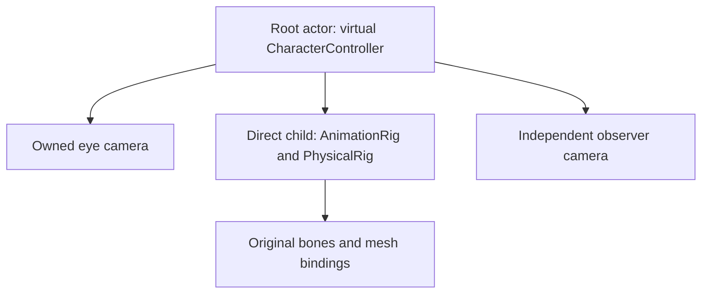
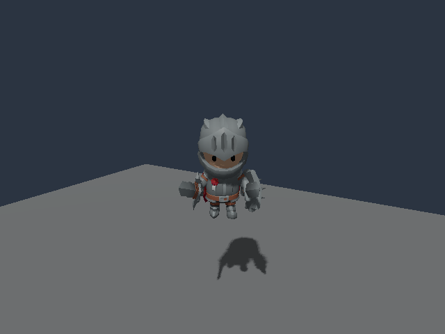
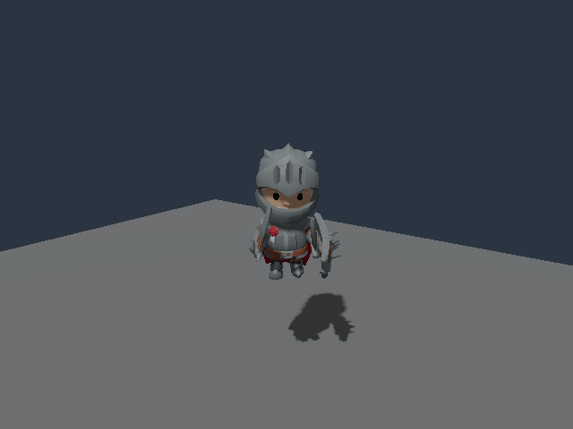
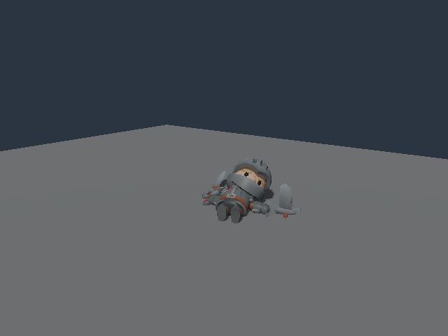

# Character movement to full-body physics

The [Physical Character Yard](../examples/physical-character-yard) combines a
virtual character controller, imported animation and a one-way physical
handoff. The same character entity and original model survive the transition;
its capsule leaves collision queries, its articulated bodies enter them, and
save/load retains the complete ownership phase.

The example uses the unchanged **KayKit Adventurers Knight** by **Kay Lousberg**,
licensed **CC0-1.0**. Supply the original GLB and notice described in the
[source manifest](../examples/physical-character-yard/source-manifest.json).
All 57 nodes, 41 skin joints, 76 animation takes and 6,952 source triangles remain
intact. The fifteen-body profile is a reviewable approximation of this stylized
character, rather than a calibrated human anatomy model.

## Author the ownership graph



Give the actor an unscaled root transform. Its animation/physical wrapper is a
direct child with an identity local transform. Parent the imported node tree to
that wrapper. The full original metric profile keeps its bodies, masses, joint
frames and source references; its explicit variant adds:

```json
{
  "pose_frame": "skeletal_bounded_scale",
  "max_scale_deviation": 0.00001,
  "controller_handoff": {
    "actor": "00000000000000000000000000000001",
    "follow": "translate_keep_heading"
  }
}
```

This is a fragment of the complete profile. Keep `initial_mode: "animated"` and
all required body/joint fields. The [physical-rig contract](PHYSICAL_RIGS.md)
defines the complete schema, scale policy and unsupported ownership combinations.
Configured root motion, IK/grounding, additional colliders/controllers and other
physical rigs currently reject within the linked actor subtree.

The example starts at `[1, 3, -0.5]`, with a 0.46-radian heading. Its virtual
capsule uses radius `0.3`, standing height `1.8`, crouched height `1.0`, walking
speed `2` and crouched speed `1`. The owned camera drops by `0.5` when crouched.
These are authored locomotion-proxy values. Changing capsule stance and choosing
an appropriate visual animation are separate game policies.

The observer camera and matching visible floor are authored before play. The
CPU workflow and rendering checks use the same frozen world and source assets.

## Trigger and inspect takeover

Run at least one completed movement tick before activation. Use
`runtime.step.physical_rigs` to stage an activation for the physical wrapper.
C# gameplay opting into `IPhysicalRigGame` uses the existing typed operation:

```csharp
// Inside Tick, when gameplay chooses to relinquish animation ownership.
context.ActivatePhysicalRig(rigId);
```

Takeover consumes the last committed final pose and its finite-difference
momentum, including resolved actor movement and animation. Add an impulse only
when gameplay intends an additional impact. Adding the controller velocity a
second time produces incorrect momentum.

Valid movement, look, jump and stance requests are superseded on the takeover
and subsequent ticks. Malformed or conflicting commands still reject the whole
batch. The actor retains its captured heading and follows the solved wrapper's
translation. The owned eye retains its captured local pitch and stance height.
This policy provides a simple death camera; eye-bone attachment, spectator
controls and recovery need their own implementation.

Read `runtime.controller_handoff` with the exact session, tick and rig entity to
inspect phase, allocated capsule ID, broadphase membership and captured support.
Suppressed motor velocity/grounding describe historical locomotion state. Read
physical parts for current velocities and actor world transforms for current
followed position. [C# commands and inspection](PHYSICAL_RIGS.md#c-gameplay)
retain their staged-write and committed-read boundaries.

## Reproduce the native workflow

Use a simulation-enabled build exposing the controller-handoff operation.
From the repository root, under an external process-tree supervisor:

```sh
python3 -B tests/physical_character_controller_handoff.py /path/to/poima \
  --source /path/to/Knight.glb --license /path/to/LICENSE.txt \
  --output build/character-controller-run
```

The output directory must be new. Under native Windows Python, pass native
Windows paths and the `.exe` without `--windows-interop`. The Python program is
an external authoring/verifying client; movement, sampling, physics, queries and
saves execute in the native engine.

The frozen sequence moves and turns during a fall from three metres. It changes
capsule stance at tick 13, blends Idle → Running_A → Death_B, and activates
physics from committed tick 22 into tick 23. The held-input branch is compared
against a neutral branch using complete saves. Later passive sampling retains
actual original source-scale changes.

The client writes its authored world and cooked package, eighteen complete save
archives, original native request/reply files, and `evidence.json`. Three
sequential engine processes exercise both an animated movement checkpoint and
a passive checkpoint, including fresh-process future continuation. Source
clocks, all node scales, animated FK, fifteen-body momentum, capsule absence,
part hits, fixed-heading follow and camera state are checked. Transcript checks
run after every service closes naturally.

## Rendered checks

The [qualification record](evidence/m2-character-controller-handoff.json)
separates Linux CPU, Windows CPU and Windows Vulkan results. Rendering restores
six original checkpoints in a byte-copied world, with every original mesh,
material and atlas preserved. An independent original-source skinning and
nearest-depth calculation includes rigid accessories and floor occlusion.
Device-depth samples distinguish a frozen played-six mesh-local palette from
the correct current deformation.

The public reference tool reproduces those calculations from a completed CPU
run, without starting the engine or a graphics device:

```sh
python3 -B tests/character_depth_oracle.py \
  --source /path/to/Knight.glb \
  --cpu-report build/character-controller-run/evidence.json \
  --output build/character-depth-reference.json
```

Each reference case names its original save slot, tick and ordered probes. Open
the authored world, configure the recorded save root and load that slot into a
guarded runtime session. Capture with observer camera
`000000000000000000000000000002bc`, `640×480`, `samples: 1`, `capture_frames: 1`,
`frames_in_flight: 1`, forward lighting and reconstruction `none`. Pass only
each probe's `x` and `y` to `scene_product_probes`; its other fields are reference
values. `world.describe` provides the focused `save.load` and `runtime.capture`
request schemas. The exported `verify_depth_samples(case, capture_result)`
function checks the raw response against the independent reference. Snapshot
before/after rendering and compare complete archive bytes to check purity.

Ten captures also check complete state before/after rendering. Warm/cold
restores reproduce the complete saved state and four whole BMP pairs. The first
render attempt remains failed at its live storage monitor; the successful
successor retains the same geometric and state requirements.

| Animated movement | First physics tick | Later physics pose |
| --- | --- | --- |
|  |  |  |

These are lossless RGB conversions of single-sample native reference captures.
They were visually inspected; the depth/state checks establish alignment and
restoration for this specimen. They do not establish polished antialiasing,
production motion/contact quality, active balance, recovery, full-body compiled
C# or Native AOT integration, crowd scaling or representative performance.
