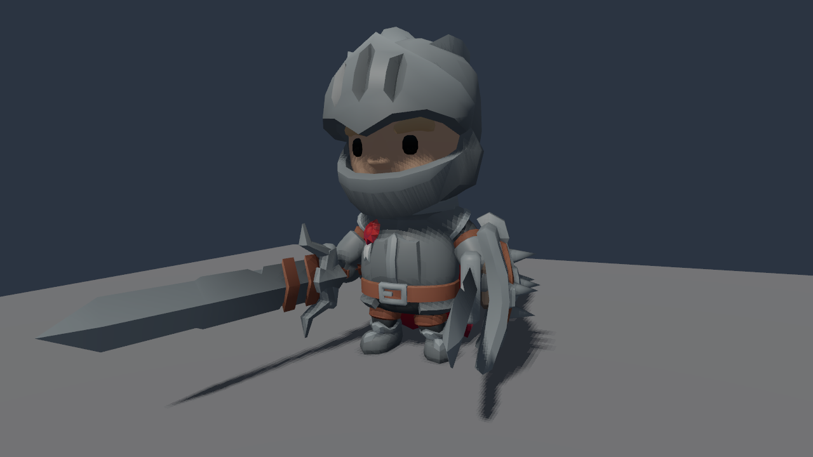

# Planted-foot locking

An optional native grounding profile keeps a planted sole at a saved location
on a static or kinematic support. It builds on [automatic contacts](GROUND_CONTACTS.md)
and the existing two-bone solver. The support may translate or rotate: the anchor
uses its physical rigid frame, excluding authored shape scale.



Native Vulkan observation of Kay Lousberg's CC0 Knight; [original source and license](CHARACTER_LIBRARY.md#original-source).

## Enable and inspect

Requires native 0.0.213, simulation and schema revision 118. This evolving
animation API is separate from the released runtime game-session v1 profile.
Native C++ consumers must rebuild for the changed layouts. The C# gameplay
services table is unchanged; existing grounding controls still require their
named feature and 368-byte prefix, supported by the retained 400-byte host.

Add `"plant_lock": true` inside the existing `AnimationRig.ik[].grounding`
profile. Retain that foot's calibrated sole offset/axes, reference height,
plant/lift heights, probe distances and correction/slope limits. Defaults remain
ordinary terrain conformance. The profile is frozen for the runtime session;
restart to adopt a changed profile.

```json
{
  "session_id": "<current session>", "tick": 12,
  "entity": "<rig>", "slot": 1,
  "include_grounding": true, "include_planting": true
}
```

Send this request to `runtime.ik`. The independent, strict Boolean
`include_planting` adds `state.planting`; a manual or nonlocking slot returns
null. Omitting it preserves the earlier response shape, including the earlier
`include_grounding` payload. Reads inspect cached decisions; they do not advance
time, resolve support frames or cast rays.

Planting reports the armed latch, decision status, optional support-local anchor,
world target sole/normal/heading and achieved positional/angular residuals.
The anchor contains its acquisition tick, support entity, original source
triangle when available, and local point/normal/heading. The original anchor
triangle is not forced onto a later probe at a coplanar triangle boundary.
`grounding.hit` remains the **actual fresh probe**; target and contact diagnostics
are separate observations.

| Planting field | Meaning |
| --- | --- |
| `armed` | Whether a valid low-foot contact may acquire a new anchor. |
| `status` | Cached decision from the last completed contact phase. |
| `anchor` | Nullable record containing `acquired_tick`, support entity `support`, nullable source `triangle`, and `local_point`, `local_normal`, `local_forward` in that body's rigid frame. |
| `target_sole` | Nullable world-space target point in metres. |
| `target_normal`, `target_forward` | Nullable world-space unit vectors for surface normal and heading. |
| `position_error` | Nullable achieved sole-to-target distance in metres, including partial-weight blending. |
| `normal_error` | Nullable achieved sole-normal angle to the target normal in radians. |

Only a locked state has the anchor, targets and residuals; other decisions use
null rather than retaining a previous stance's values. Source triangle IDs are
unsigned 32-bit values when the probe supplies them.

## Acquisition, holding and release

An initially armed foot can acquire an anchor after a valid ordinary contact
when its prepared animated sole is at or below `plant_height`. The existing
model-space height policy remains an explicit heuristic, not gait annotation.
Capture consumes the armed latch. A held anchor follows the body's committed
position and rotation, retaining both sole position and heading.

Each eligible held foot probes vertically below its transported anchor, rather
than below its moving animated sole. The fresh hit must belong to the same
eligible body, be within **0.001 m** of the transported point and agree with its
normal within **0.001 radians**. A different face or intervening body cannot
silently retarget the anchor. These are validation tolerances, not a promise of
millimetre physics precision at every supported coordinate.

Both feet prepare from the same blended, root-stripped pose. Sampling jobs join
before the owner reads support frames and casts rays; solving can then use the
owned decisions. At most one ray is made per eligible foot. A missing held
support releases without a ray. The existing two-feet-per-rig and 64-feet-per-world
limits include disabled/locking profiles; there are no adaptive recasts.

Existing height fading still blends the correction toward source animation.
Reaching `lift_height` releases the anchor and rearms acquisition. Requested
disable or zero weight also clears the anchor and rearms it, without probing.
Use the existing CLI grounding controls or C# `IGroundingControlGame` to request
that policy; no new gameplay service prefix is needed. The C# interface reads
requested enable/weight, while cached anchor diagnostics use `runtime.ik`.
This checkpoint does not add a C# anchor getter or a dedicated desktop rig
calibration/planting panel.

For a held foot, a missing or changed support, failed validation, unsuitable
normal/heading, excessive correction or unreachable target clears the anchor
and disarms it.
It cannot acquire another anchor every subsequent planted tick. Until lift or
explicit disable rearms it, the foot uses ordinary terrain conformance. This
avoids a constrained foot repeatedly ratcheting forward into a new stance.
Partial requested weights blend the achieved pose, so a target anchor alone
does not imply the actual sole is perfectly fixed.

The character wrapper retains grounding's upright positive-uniform restriction;
the support can rotate in three dimensions. Original affine ankle offsets and
positive end-joint scales are retained under the selected IK metric profile.
The solver never moves the pelvis or stretches a limb to hide an unreachable
anchor. Natural lift uses the existing height fade; forced failure release has
no additional inertial transition and can be abrupt.

## State and failures

Planting statuses are `uninitialized`, `disabled`, `lifted`, `seeking`,
`disarmed`, `locked` and explicit `released-*` reasons. Only `locked` retains
an anchor, all three target vectors and their achieved residuals. Disabled,
lifted and seeking states are armed; locked, disarmed and failure-release states
are not. A failed fresh acquisition whose support frame is unavailable may
retain an ordinary contact while reporting `released-support-lost`.
The complete release reasons are `support-lost`, `support-changed`,
`anchor-error`, `miss`, `no-normal`, `slope`, `heading-degenerate`,
`correction-limit` and `unreachable`, each prefixed with `released-`.

New grounding decisions `plant-support-lost`, `plant-support-changed` and
`plant-anchor-error` identify held-anchor failures. Other contact rejection
reasons retain their earlier names. Invalid matrices, malformed input and
provider exceptions fail the complete tick batch; they do not become clear
space or an invented successful contact. Rollback retains anchors, latch,
controls, counters, physics and gameplay together.

## Save and restore

A session containing an authored `plant_lock:true` selects nested animation
state **version 10**, even before acquisition. It stores the complete profile,
requested controls, anchor/latch, cached contact, targets and residuals. Its
`legacy_version` selects the existing 7/8 control layout; strict `retimed`
selects the existing rate-overlay fields. Version 9 remains the separate
rate-overlay encoding. Sessions without planting retain their earlier 1–9
formats and shapes.

Restore preserves saved numbers. Animation reconstruction checks achieved sole
geometry and both contact/anchor residuals without invoking contact or support
providers. The enclosing native runtime also verifies support membership,
exclusion and anchor-to-target consistency against already restored physical
body poses, with a `1e-6` per-component integrity tolerance (metres for positions). That is
a body-pose integrity read, not a new surface probe or anchor capture. The next
completed physics tick refreshes support validation. Existing physics restore
may independently rebuild its own contact information.

Anchors use finite body-local points within ±4,000,000 m per axis; cached world
targets stay within grounding's ±1,000,000 m query range. Saved local normal and
heading must be unit and orthogonal within `0.000001`. Their numerical domains
do not establish contact quality at extreme distances.

## Qualification scope

[Native fixtures](../tests/runtime_foot_planting_native.cpp) use independent
analytic rigs and actual Jolt supports, including off-centre translation,
yaw/tilt, authored shape scale, failure latching, complete saves and later-tick
rollback. The [original-character verifier](../tests/runtime_foot_planting.py)
retains the licensed Knight's geometry and animation curves, checks all 57
node transforms, and measures actual support-relative sole drift.

[Recorded 0.0.213 qualification](evidence/m2-foot-planting.json) passes six native
groups on Linux and Windows. Each platform's original-character workflow retains
127 literal RPCs, seven complete archives and four whole-byte pairs across
warm/cold continuation. Separate Windows NVIDIA observations capture two saved
poses with unchanged state; they do not establish animated walking quality.

Run the original-character check from the repository root with a fresh output
directory whose parent already exists:

```sh
python tests/runtime_foot_planting.py --binary <native-executable> \
  --source <original-Knight.glb> --license <original-LICENSE.txt> \
  --output <fresh-result-directory>
```

Use the pinned original inputs described by [character library intake](CHARACTER_LIBRARY.md).
The verifier owns its native sessions, retains literal requests/responses and
compares complete checkpoint bytes. Run it under a bounded process-tree owner.
It requires neither a renderer nor a new C# build. Windows rendering is a
separate observation scope; headless success does not establish rendered gait
quality or physical interaction.

This is a sole-point and orientation constraint. Whole-shoe clearance, heel/toe
articulation, pelvis/full-body balance, dynamic-body support, general contact
detection and production crowd/gait quality remain further work. The current
height policy does not infer jumping, climbing, death or arbitrary clip intent.
Games should request suitable contact controls for those states.

Design references include Daniel Holden's July 2026
[foot-locking discussion](https://theorangeduck.com/page/inverse-kinematics-foot-locking)
and Epic's [moving-platform motion reconstruction issue](https://issues.unrealengine.com/issue/UE-305539).
These inform design choices; they do not qualify Poima's implementation or
supply its code or assets.
