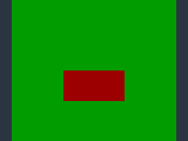
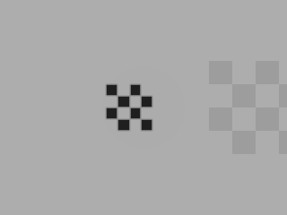

# Alpha-masked materials

Alpha masking cuts holes in a surface using base-color texture alpha. Surviving
fragments remain opaque and participate in the ordinary lighting, depth and
shadow paths. Use it for leaf cards, grilles and other cutout surfaces.

## Author and inspect

Set the complete `PbrMaterial` through a revision-guarded `world.transact`:

```json
{
  "op":"component.set", "id":"<entity>", "type":"PbrMaterial",
  "value":{
    "base_color":[0.3,0.5,0.2], "emissive":[0,0,0],
    "metallic":0, "roughness":0.8, "double_sided":true,
    "alpha_mode":"mask", "opacity":1, "alpha_cutoff":0.5
  }
}
```

The original five material fields remain required. The three alpha fields are
optional:

| Field | Default | Domain and meaning |
| --- | --- | --- |
| `alpha_mode` | `opaque` | `opaque` ignores alpha; `mask` tests it. |
| `opacity` | 1 | Finite 0–1 multiplier for base-color alpha. |
| `alpha_cutoff` | 0.5 | Finite 0–1,000,000 threshold. |

A masked fragment is discarded when `texture_alpha * opacity < alpha_cutoff`.
Equality survives. A missing base-color map supplies alpha 1. Alpha is linear
even when the base-color image's RGB uses sRGB. Existing image samplers,
UV coordinates and texture overrides apply.

Cutoff zero therefore keeps even zero-alpha samples. A cutoff greater than one
discards the entire masked surface. Opacity does not create partial blending;
opaque mode renders the full surface even when opacity or texture alpha is zero.



*A synthetic imported quad after source-removed save restoration. Green shows
through discarded texels; the remaining texels stay opaque.*

`entity.get` returns the authored fields. `entity.material` reports the resolved
material and texture bindings. Effective materials retain their original
five-field response when all alpha settings are defaults; otherwise they expose
all three alpha fields as well. Defaults explicitly authored as opaque/1/0.5
also use the five-field effective response.

The desktop Inspector provides Alpha mode, Opacity and Alpha cutoff controls.
They edit the same component and retain the normal draft/revision checks.
Use live discovery for the installed build's schema and supported operations.

## Imported content and cooked models

glTF/GLB `OPAQUE` and `MASK` materials retain `baseColorFactor[3]` as opacity and
`alphaCutoff` as the threshold. Imported base-color textures retain their alpha
channel. Poima's supported profile bounds the cutoff as above and rejects
blended materials. Existing FBX transparency restrictions remain unchanged;
an arbitrary FBX opacity setting does not imply a cutout material.
Alpha values reject duplicate fields and incorrect JSON types. Escaped aliases
for `materials`, `alphaMode`, `alphaCutoff`, `pbrMetallicRoughness` and
`baseColorFactor` reject instead of letting the underlying importer silently
omit alpha data.

Nondefault alpha semantics use `POIMAM05` cooked packages, with explicit static
or animated ownership. These retain geometry, textures, skins and clips through
the ordinary asset workflow. Older engines reject this package version instead
of silently drawing a masked surface as opaque. Packages 1–4 retain opaque
defaults. The default opaque writer preserves the existing static-v3 and
animated-v4 encodings and identities.

Move the cooked asset directory with the world or export it through the normal
content closure. Original source images/models are not required for reopening
cooked materials. Image overrides preserve the distinction between absent
members (inherit), null members (disable) and explicit asset references.
Export requires the runtime's engine version to match the exporter exactly;
an older installed runtime is rejected before bundle staging.

## Rendering and shadows

The shared alpha test applies before writing forward color, deferred material
products, world depth, normals or motion correspondence. Discarded texels leave
the actual background's products intact. The same rule applies to rigid and
skinned geometry and to separately projected foreground geometry.

Masked shadow casters use the material's base-color map, sampler, opacity and
cutoff in a shadow fragment shader. Opaque casters retain their depth-only path.
The render schedule declares the masked shadow texture reads and validates the
actual bindings. Light-space and camera-space texture footprints can select
different mip levels; matching material rules do not imply identical screen
and shadow-map pixels.



*A separate controlled shadow probe: the caster's cutout pattern also appears
in its shadow.*

Foreground sample coverage remains an independent compositing quantity. A
material's opacity does not replace the foreground coverage channel. Existing
one-sample scene-product and deferred restrictions remain in force.

## Live edits, persistence and recovery

The existing [live material operation](LIVE_MATERIALS.md) also adopts
`alpha_mode`, `opacity` and `alpha_cutoff` on selected explicit PBR drawables.
Author first, read the live session/tick/content and material guards, then call
`runtime.material.apply`. Every selected material must change. Double-sided
state, geometry and unrelated authored edits remain outside that operation.

Adoption publishes the material and frozen save baseline atomically while
preserving physics, gameplay, components, animation and existing immutable
snapshots. Exact retained retries return the original receipt. Stale guards,
invalid fields and unrelated edits reject without partial adoption. Inspect
accepted native values through `runtime.material.inspect`; use capture or
presentation receipts to establish which snapshot reached rendering.

Texture changes use the separate guarded texture operation. Both paths share
the existing material revision and presentation-history cut policies. These are
explicit synchronous changes, not a promise of hitch-free uploads or shader
work. Save/load retains the authored alpha recipe through normal content
identity checks; the gameplay call ABI is unchanged.

## Limits

Physics and weapon queries use collision geometry. A texture hole does not cut
a hole in a triangle collider. Author actual geometric apertures or suitable
query collision for gameplay that must pass through a grille.

This is hard clipping, including at 4× MSAA. Alpha-to-coverage, coverage-aware
mipmap generation, blended transparency, wind and dense-foliage rendering are
separate work. Ordinary filtered alpha mips can lose coverage at distance.
Geometric motion products do not establish reconstruction acceptance or masked
temporal image quality. A tiny cutout fixture is not a foliage performance or
production asset-quality qualification.

## Check the workflow

In a configured Linux simulation build, retain the CPU fixture's original
packages and malformed inputs in a new directory:

```sh
cmake --build build/linux-game --target poima poima-model-alpha-test -j 2
./build/linux-game/poima-model-alpha-test --output build/alpha-codec-check
python3 tests/material_alpha_contract.py --binary build/linux-game/poima \
  --output build/alpha-authoring-check
```

Both output paths must be new and their parent must exist. The protocol test
retains original requests/responses, complete checkpoints and adoption
differences; it checks native simulation and persistence without rendering.
Its Windows execution requires an enclosing process Job before startup.

In a configured Windows Vulkan build, compile
`poima-material-alpha-capture-test`. From PowerShell at the repository root:

```powershell
$out = Join-Path (Get-Location).Path 'build\alpha-render-check'
& .\build\windows-runtime\bin\poima-material-alpha-capture-test.exe $out 0 forward 1
```

The positional arguments are a new absolute output directory, GPU index,
`forward` or `deferred`, and sample count. Supported combinations are forward
1×/4× and deferred 1×. Each invocation retains fifteen original captures and
product/shadow checks. Use a different output directory for every invocation.
The [checkpoint evidence](evidence/m2-material-alpha.json) records the tested
devices and separates these controlled probes from broader graphics quality.

The authored/live/cold Python check needs an enclosing Windows Job. With native
Windows Python, this PowerShell recipe uses the repository's existing process
owner. The run directory must be new; change `--gpu` to select another adapter.

```powershell
@'
import json, os, sys
from pathlib import Path
root = Path.cwd()
sys.path.insert(0, str(root / 'tests'))
from switchback_ownership import gated
run = root / 'build' / 'alpha-live-check'
run.mkdir()
os.environ['POIMA_JOB_WORKERS'] = '2'
result = gated([sys.executable, str(root / 'tests/material_alpha_live_capture.py'),
    '--binary', str(root / 'build/windows-runtime/bin/poima.exe'),
    '--output', str(run / 'result'), '--gpu', '0'], run / 'job', 210)
(run / 'ownership.json').write_text(json.dumps(result, indent=2) + '\n', encoding='utf-8')
if not result['passed'] or result['forced_cleanup']:
    raise SystemExit(1)
'@ | python
```

It retains nine original images, eighteen complete checkpoints and ten full
byte comparisons, including a fresh-process restore after the source GLB is
moved out of its original namespace. The cooked package and original source
bytes remain available for inspection. It does not require C# or a player host.

If a surface disappears entirely, inspect the resolved texture binding,
opacity and cutoff; a cutoff above the largest alpha product intentionally
discards it. If a visible hole still blocks a shot, inspect collision geometry:
the material test does not affect physics. For a live edit, inspect the accepted
material revision and the actual capture/presentation receipt before concluding
that an authored change reached the player.

The alpha law follows the [Khronos glTF material specification](https://registry.khronos.org/glTF/specs/2.0/glTF-2.0.html#alpha-coverage).
Vulkan [fragment operations](https://docs.vulkan.org/spec/latest/chapters/fragops.html)
define fragment discard and depth/coverage behavior; alpha-to-coverage is a
distinct multisample operation.
