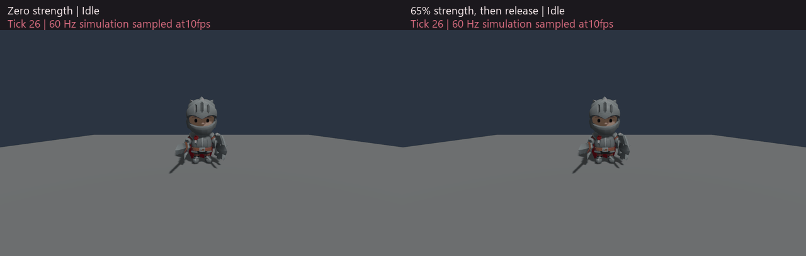

<!-- SPDX-License-Identifier: Apache-2.0 -->
# Animation targets for physical characters

An opted-in [PhysicalRig](PHYSICAL_RIGS.md) can use animation clips as targets for
its [joint drives](PHYSICAL_DRIVES.md). Physics continues to solve the bodies,
contacts and skeleton. Animation supplies desired joint orientations; the drive
strength, gains, torque caps and external forces determine how closely each
joint follows them.

This supplies physical animation targets. Balance, protective steps, locomotion
forces, target-velocity feedforward and recovery to animation remain separate
work. A driven character can still fall or fail to reach its target.

## Authoring and ownership

Add the following property to a PhysicalRig with at least one configured joint
`drive`:

```json
"animation_drive": { "limit_policy": "fit" }
```

The policy is frozen for the runtime session. The rig must already have its
validated AnimationRig, model, body-to-bone calibration and joint frames.
The target player shares those frozen clips and layer definitions. It has an
independent base clock, layer clocks, transitions, playback rates and pose
histories. It does not create another scene entity.

Target playback excludes root-motion extraction, IK, grounding and skin
publication. It does not edit the original animation clocks or historical
procedural handoff. Ordinary animation, IK, grounding and root-motion writes
remain subject to the existing physical ownership rules.

Every configured drive begins with the `manual` source. The independent player
advances once per fixed tick even when no joint currently follows animation.
Selecting `animation` supplies that tick's sampled orientation on the next
successful step. It requires explicit physical takeover, which may occur earlier
in the same ordered command batch.

| Source | Target and strength |
| --- | --- |
| `manual` | Holds the effective target. Switching sources can set strength without changing that target. |
| `animation` | Follows the independent player's fitted joint orientation, with the requested strength. |

A manual `drive` write also selects `manual`. A source change does not restore
animation ownership. Zero strength disables active drive torque while retaining
source selection; an animation source still samples its target at zero strength.
Passive joint response and contacts remain active.

## CLI and service controls

Use the existing guarded `runtime.step` operation. An element of its
`physical_rigs` array can activate the rig, select a source and change the target
base clock:

```json
{
  "entity": "00000000000000000000000000000400",
  "activate": true,
  "drive_source": { "joint": "elbow", "source": "animation", "strength": 0.5 },
  "animation": {
    "clip": 0, "time": 0, "speed": 1,
    "loop": true, "playing": true,
    "blend_ticks": 12, "transition_mode": "crossfade"
  }
}
```

Use the actual entity, joint and clip identities from discovery and inspection.
Omit `activate` when the rig is already physical. Select other joints with
additional array entries. Each joint remains independently controllable.

`animation` uses the ordinary animation replacement fields and bounds, including
`transition_mode: "inertial"`. For an authored layer, provide `layer`, `weight`
and any `weight_blend_ticks`; its mask and override/additive mode remain frozen.
A `null` clip selects the authored rest pose.

`animation_rate` changes speed without seeking or restarting a transition:

```json
{
  "entity": "00000000000000000000000000000400",
  "animation_rate": { "speed": 0.5 }
}
```

Add `layer: 1` to select that authored layer instead of the base. Layer slots
are 1–4, speed is 0–8, explicit time is 0–1,000,000,000 seconds, and transition
and weight-fade durations are 0–3,600 ticks. Layer weights and drive strengths
are 0–1. Invalid values reject; they are not silently coerced.

Within one physical command, ordering is activation, impulse, manual drive,
source selection, playback replacement, then rate change. Caller commands
precede staged gameplay commands. There are at most 64 combined physical
commands per tick. Two source/manual writes to the same joint reject, as do
replacement/rate writes to the same base or layer channel. Different channels
may be edited together.

Late sampling or fitting failures roll back the entire enclosing batch,
including target clocks, histories, source selection, physics, gameplay and
pending save intents. An accepted staged C# call is not proof that the step
committed.

## Fitting and observation

`strict` requires every sampled target to satisfy the joint's existing manual
orientation admission. An invalid target rejects the step.

`fit` explicitly projects hinge swing away, clamps signed twist to the authored
interval, and projects swing into the joint's ellipse using a bounded solve in
the quaternion swing chart. This preserves the authored joint limits. It does
not change manual target validation or claim the globally nearest rotation.
Singular swing/twist charts and the ambiguous signed-twist cut reject instead
of selecting an arbitrary fallback.

Targets are computed from logical bone quaternion chains and the authored
body/joint calibration. They are joint-relative orientations, not local bone
rotations, world poses or matrix/shear decompositions. Animation translations
and scales do not create body translation or root-support forces.

`runtime.physical_animation` requires `session_id`, current `tick` and `entity`.
It returns the committed target playback, sampled tick, limit policy and one
entry per configured drive. Each entry reports `manual` or `animation` and an
optional current sample:

- Requested and fitted joint-relative XYZW rotations.
- Angular correction in radians and chart condition.
- Hinge-projection, twist-clamp and swing-clamp flags.

Unlayered playback omits `layers`; it does not return an empty layer array.
The complete saved player still includes `layer_history`.

Manual entries have `sample: null`; they do not retain misleading attribution
to an old animation frame. An existing entity without `PhysicalRig.animation_drive`
returns null. Missing entities and stale guards reject.

Use `runtime.physical_rig` with `include_joints: true` to inspect effective
native controls, strength, errors and saturation. Fitted intent, effective
control and solved body pose are separate observations. Backend quaternion
canonicalization can introduce a normalization-resolution difference between
fitted intent and effective control.

## C# gameplay

Declare `IPhysicalRigAnimationGame` on the game class. During `Game.Tick`:

```csharp
context.ActivatePhysicalRig(rig); // Only if currently Animated.
context.SetPhysicalRigAnimation(rig, clip: 0, blendTicks: 12);
context.SetPhysicalRigDriveSource(rig, "elbow",
    PhysicalRigDriveSource.Animation, strength: 0.5);
```

Additional methods are `SetPhysicalRigAnimationLayer`,
`SetPhysicalRigAnimationSpeed`, `SetPhysicalRigAnimationLayerSpeed`,
`GetPhysicalRigAnimation`, `GetPhysicalRigAnimationLayer` and
`GetPhysicalRigDriveSource`. Existing `GetPhysicalRigDrive` reads the effective
target, strength and gains. Reads expose the committed boundary, including
when called after a write staged in the same callback.

The marker inherits physical-rig and drive access. It does not grant the
separate ordinary-animation, IK or root-motion extension APIs. There are at
most 1,024 attempted target-player reads per Tick, shared across its three read
callbacks. Its writes share the existing 64 physical command attempts.

The native interface appends six callbacks to the frozen 448-byte prefix:
services epoch 7, total 496 bytes, named feature `physical_rig_animation_v1`.
It requires `physical_rig_v1` and `physical_rig_drive_v1`. The source-state and
source-command records are 208 and 56 bytes; playback records reuse the
existing typed layouts. See [gameplay_abi.h](../include/poima/gameplay_abi.h).
Older consumers retain their negotiated prefixes. Extent, feature permissions,
record validation and actual consumer compatibility remain separate checks.

## Persistence

Authored target playback selects physical save extension 6, including when the
only opted-in rig is in a dormant template. Non-opted worlds retain their
existing extension and field encodings.

Saves retain the complete independent player, base/layer current and previous
histories, per-joint sources and current samples, alongside effective native
controls. This includes histories needed by a future first inertial transition.
Current histories are checked against their playback clocks, using a
componentwise numerical reconstruction bound of
`1e-12 * max(1, abs(saved), abs(recomputed))`; original saved values are retained.
Previous histories are retained and structurally validated rather than
regenerated from newer controls. This is state validation, not archive
cryptographic authentication.

Warm load, fresh-process continuation, template birth/retirement and rejected
transactions must preserve the complete state. Qualification evidence is linked
from the implementation status; a valid save format alone does not establish
cross-platform future bit identity or production character quality.

## Reproduce the focused checks

Use a simulation-enabled build with a matching runtime and gameplay SDK. The
native tests cover target math, authoring, detached histories and complete
physical continuation:

```sh
cmake --preset linux-game
cmake --build build/linux-game --parallel 2 --target \
  poima-physical-target-test poima-physical-animation-json-test \
  poima-runtime-animation-target-test poima-runtime-physical-animation-test
ctest --test-dir build/linux-game --output-on-failure \
  -R '^(physical_target_native|physical_animation_json_native|runtime_animation_target_native|runtime_physical_animation_native)$'
```

The CLI workflow is `tests/physical_animation_protocol.py`; pass the native
executable as its positional argument and a fresh directory with `--output`.
It checks typed controls, fitting, rejected transactions and complete warm/cold
saves. It uses a small analytic rig, so it is not a character-quality benchmark.

The compiled workflow is `tests/physical_animation_gameplay.py`. Build
`managed/Poima.ManagedBridge/Poima.ManagedBridge.csproj` and
`tests/managed_physical_animation_gameplay/Poima.ManagedPhysicalAnimationGame.csproj`
in Release using the same SDK. Pass the executable plus `--hostfxr`, `--bridge`,
`--assembly` and a fresh `--output`. Use the native platform's hostfxr library;
the bridge and game are managed DLLs. The workflow checks all 54 gameplay fields
and 352 bytes of typed state, all six target callbacks, staged-read behavior,
rollback, same-image reload and three-process continuation.

Both Python workflows need an external process-tree supervisor with a finite
deadline. Preserve their literal requests, responses and original failure
records. The compiled workflow currently exercises CoreCLR; synthetic interface
checks or publisher support do not establish new-target NativeAOT execution.

## Observed imported-character motion



The original [licensed Knight](../examples/physical-character-yard/source-manifest.json)
follows the same Idle, Running_A and returning Idle targets in both branches.
The left branch has zero active drive strength; the right uses the sample's
authored 0.65 strength before release. Passive joints and contacts remain active.
The body and limb postures differ, but both characters fall. This mechanism
supplies joint targets without balancing the character.

These are complete Vulkan frames sampled every six simulation ticks: 60 Hz
simulation shown at 10 fps, with resizing and GIF palette conversion. The
[qualification record](evidence/m2-physical-animation-targets.json) retains the
original frame identities, complete saved-state comparisons and inspection
scope. This is a sampled response demonstration; it does not establish
continuous motion quality or representative performance.
