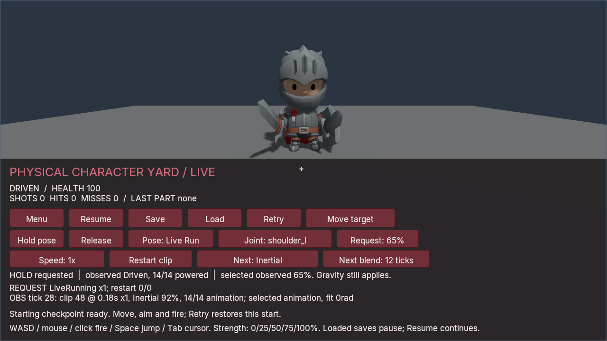
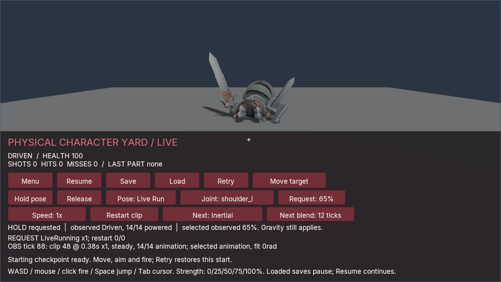
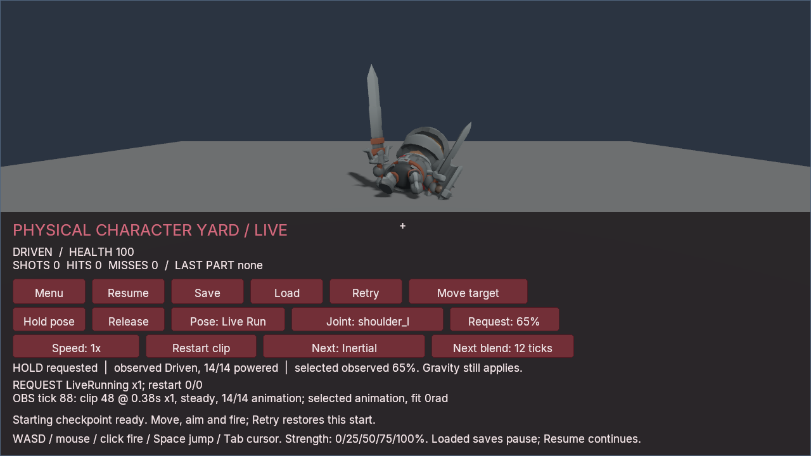

# Physical animation velocity tracking

Physical animation can supply both the fitted joint orientation and its motion
over the next fixed step. Enable it in the authored `PhysicalRig`:

```json
"animation_drive": { "limit_policy": "fit", "velocity_tracking": true }
```

Omission or `false` keeps the existing orientation-only controller. The
canonical writer omits `false`. A configured joint still needs a drive profile,
explicit physical takeover and selection of the `animation` source. Existing
[CLI and C# playback/source controls](PHYSICAL_ANIMATION.md) apply; the managed
services table remains epoch 7, with the same 496-byte prefix.

The [Physical Character Yard](../examples/physical-character-yard/README.md)
preparer accepts `--velocity-tracking`. Its clip, rate, transition, strength and
release controls are shared with the orientation-only sample.

## Meaning of the target

Each fixed step evaluates two poses on the **post-command** target trajectory:
the current tick and the upcoming tick. Both pass through the declared
strict/fit joint-limit policy. The controller uses the upcoming orientation and
the principal rotation from the fitted start to that endpoint, divided by the
step duration. Angular velocity is expressed in the parent joint's coordinates,
in radians per second.

This is an interval average, not an analytic derivative. It does not reconstruct
turns hidden between samples. Immediate clip replacement and restart use the
new trajectory at both endpoints, so a jump from an unrelated previous clip is
not treated as physical target velocity. Crossfades, inertial transitions,
layer weights and rate changes participate in the sampled trajectory. A paused
clip can still have a moving target while a transition advances. Manual holds
have no target-motion attribution.

The fitted start is retained explicitly: completed transitions can discard
clock information needed to reconstruct that start later. A joint still
samples at zero strength. Zero strength applies no active torque and does not
change pose ownership or disable the underlying passive response.

Intervals with `abs(delta.w) <= 1e-8` reject because the shortest rotation is
ambiguous near π. Other invalid/nonfinite values and speeds above the existing
20,000 rad/s per-axis admission bound also reject; there is no silent speed
clamp or smoothing filter. This large admission bound is not a recommended
character speed. Torque remains limited by the authored drive and strength.

## Controller

Let `h` be the fixed timestep, `k` and `d` the strength-scaled gains, `A` the sum
of the two world inverse-inertia tensors, `ω` the measured relative angular
velocity and `v` the target velocity transformed by the current physical parent
joint frame. The local solve is:

```text
[I + h(d + hk)A] τ = k e(endpoint, current) - (d + hk)ω + d v
```

The endpoint already includes target advancement; adding `hk v` again would
predict that movement twice. Hinge drives project onto the calibrated parent
joint X axis. The torque cap uses one vector-norm scale, and parent and child
receive equal and opposite internal torques. Exact zero target velocity uses
the original arithmetic path.

The reference-velocity term follows the motivation in
[Tan, Liu and Turk's Stable Proportional-Derivative Controllers](https://faculty.cc.gatech.edu/~turk/my_papers/stable_pd.pdf).
Poima uses its own local endpoint/chordal formulation and capped torque pairs;
the paper's complete articulated formulation and stability claims do not
transfer automatically. Contact forces, gravity and interaction between joints
still affect tracking. This adds no inverse dynamics, acceleration feedforward,
root force, balance, protective stepping or recovery controller.

## Inspection, persistence and failure

For enabled rigs, `runtime.physical_animation` adds `velocity_tracking: true`.
Each joint adds `motion`: `null` for manual ownership, otherwise
`{start_rotation, angular_velocity}`. The existing sample contains the fitted
endpoint. `runtime.physical_rig` with joints requested adds
`drive.target_angular_velocity` when motion is present. Its evaluated torque
remains a calculation at the committed state, not a historical applied torque.
These inspection calls do not advance playback or wake bodies.

Worlds containing an enabled live rig **or dormant template** use physical save
extension 7. Enabled target players use target document version 2 and retain
the full interval alongside their existing complete player histories. Legacy
worlds keep their earlier extension and target representations. The reader
checks motion membership, strict legality of the fitted start, recomputed
interval velocity and the exact join to backend drive state. Recomputed
velocity admits at most `1e-10` rad/s componentwise reconstruction error;
admitted original values are retained, not replaced. A retained legal interval
is not proof that a post-transition clock can reconstruct its earlier start.

Invalid sampling or controls reject the enclosing batch and restore its whole
checkpoint. Old saves are not automatically migrated into a world whose frozen
physics configuration has changed. Configuration, save-format and native ABI
compatibility remain separate boundaries.

## Reproducible checks

With a [configured native simulation build](BUILD.md):

```sh
cmake --build build/linux-game --parallel 2 --target \
  poima poima-physical-drive-math-test poima-physical-animation-json-test \
  poima-runtime-physical-animation-test poima-physical-state-json-test
ctest --test-dir build/linux-game --output-on-failure \
  -R '^(physical_drive_math|physical_animation_json_native|runtime_physical_animation_native|physical_state_json_native)$'
python3 tests/physical_animation_protocol.py build/linux-game/poima \
  --velocity-tracking --output /absolute/fresh/velocity-check
```

Run the CLI check under an owned process-tree supervisor when collecting
qualification evidence. It writes original requests, responses and complete
save archives. Omit `--velocity-tracking` to exercise the unchanged
orientation-only workflow. The native runtime test accepts
`POIMA_TEST_ARTIFACTS=/absolute/fresh/native-check` to retain its full snapshots
and pair manifest. Reusing an existing artifact directory is rejected.

## Qualification

The [0.0.236 record](evidence/m2-physical-target-velocity.json) covers 21 selected
native tests on Windows and Linux. The physical-animation fixture retains 366
archives, 153 whole-state pairs and 45 rejected mutations per platform. It
checks post-command sampling, completed fades, inertial continuation, manual
ownership, zero strength, fitted limits, dormant templates and atomic failure.
An isolated moving-hinge math case compares identical curves and gains; it
passes its thresholds of at least 40% lower RMS error and 50% lower phase-lag
projection. Those thresholds are not character-motion or performance promises.

The CLI workflows separately exercise default and enabled profiles on both
platforms: 119/147 RPCs, 40/46 complete saves and 21/24 whole-file pairs. Four
analytic curve checks and one control-branch witness inspect interval motion.
All three engine processes in each workflow close naturally.

In the 0.0.236 record, the retained 104-field Windows NativeAOT character game
also passes with its original orientation-only profile. Its module is unchanged;
this does not qualify the sample's optional velocity mode or a new export.
No new rendered motion, physical input, frame-time or cross-platform bit-equality
result is claimed by these CPU checks.

## Imported-character workflow

The [0.0.237 record](evidence/m2-character-target-velocity.json) exercises the
unchanged 104-field NativeAOT character game with velocity tracking enabled on
runtime 0.0.236. Prepare a fresh project using the sample's `--velocity-tracking`
option, then use the same flag in its complete gameplay verifier:

```sh
python tests/physical_character_animation.py \
  --binary /path/to/poima.exe --world /path/to/new-project/world.json \
  --source /path/to/Knight.glb --license /path/to/LICENSE.txt \
  --backend native_aot --descriptor /path/to/native-gameplay.json \
  --velocity-tracking --output /absolute/fresh/character-velocity-check
```

Use native Windows Python and an external process-tree owner for this recorded
Windows workflow. The [sample guide](../examples/physical-character-yard/README.md)
explains content preparation and native publication. An already compatible
496-byte game module needs no rebuild to use this authored option. Omit both
velocity flags to exercise the original profile; the verifier rejects a profile
that does not match its selected mode.

The check covers all 104 gameplay fields, original character nodes, target
histories and motion/backend joins. It passes 838 RPCs, 28 verifier archives and
fifteen complete equality pairs; the ordinary initial game checkpoint is also
verified. Five focused intervals check requested endpoints against independently
sampled original Running_A curves. Seven joints per interval supply independently
legal starts; the others retain the native fitted starts and secant checks.
Restart uses the new trajectory, zero strength still samples motion, an
unblended zero-rate clip stops target motion, and release clears automatic
motion. Complete original state is restored before the earlier workflow continues.

Separate rendered lanes use identical gameplay inputs, camera, art, gains,
limits and 1280×720 four-sample settings. Their authoring identities and receipt
IDs remain separate. Every capture preserves its whole saved state.

| Active checkpoint | Orientation-only RMS error | Velocity-tracked RMS error |
| --- | ---: | ---: |
| Tick 29, after the transition | 0.463013 rad | 0.383932 rad |
| Tick 89, sixty ticks later | 0.640003 rad | 0.495302 rad |

These are joint-orientation errors at two selected instants, not a general
quality score. Both characters fall; velocity tracking does not provide balance.

| Checkpoint | Orientation only | Velocity tracking |
| --- | --- | --- |
| Tick 29 |  |  |
| Tick 89 |  |  |

The images are lossless copies of native captures using the original CC0 KayKit
Knight. All eight full-resolution views, including grounded and released states,
were inspected. Four stills per lane cannot establish jitter, smoothness or
continuous motion quality. UI layout readbacks can come from a subsequent
presentation at the same paused tick and UI revision, rather than the exact BMP
frame. The original raw captures, frame receipts and failed wrapper record remain
identified separately in the qualification record.
