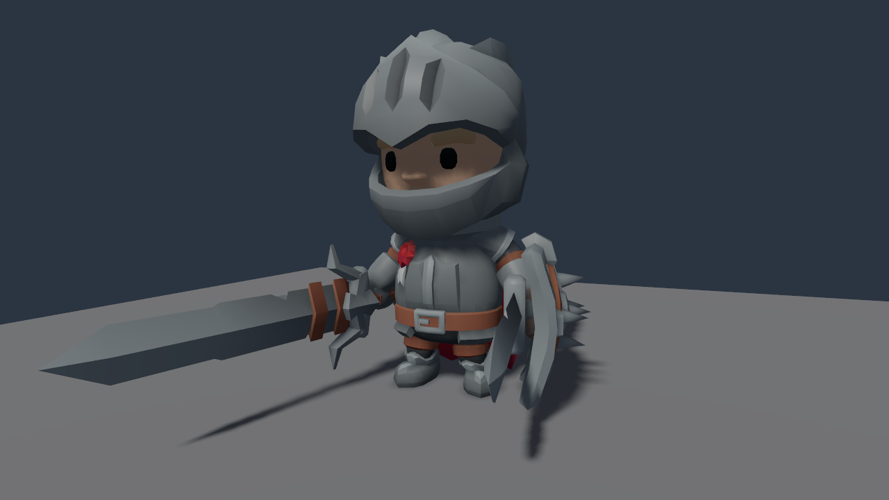
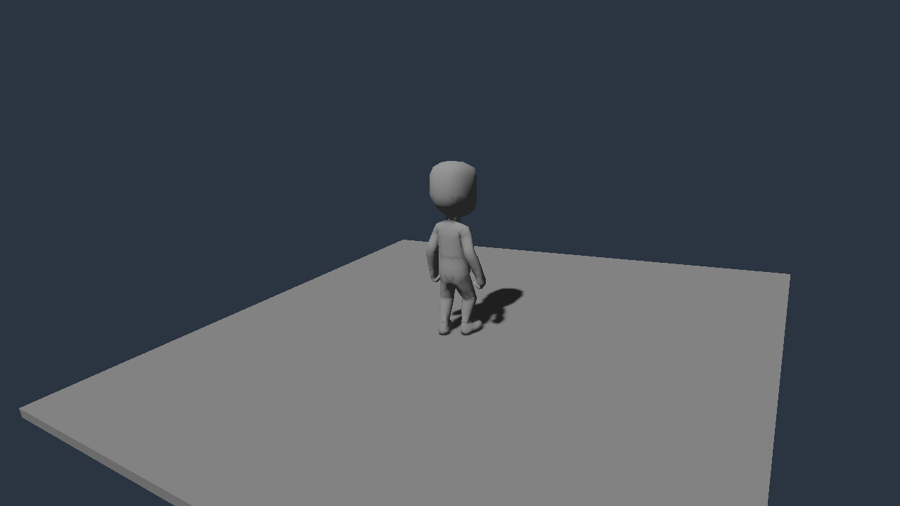
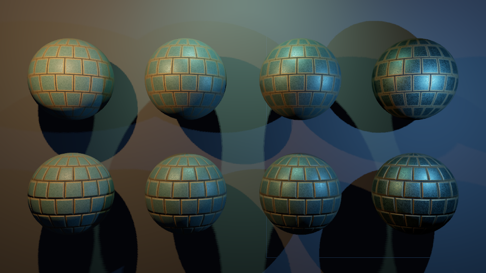

# Shadow maps

Poima 0.0.11 adds optional Vulkan shadow maps for all three authored light kinds. Settings are available through the native world service, freeze with a runtime session, and apply to both captures and continuous play. This establishes raster visibility for the compatibility graphics tier. It does not complete the production renderer or implement ray-traced shadows, ReSTIR or virtual shadow maps.

## Authoring

Add a `shadow` object to a Light component. Absence preserves the previous unshadowed behavior:

```json
{"op":"component.set","id":"00000000000000000000000000000002","type":"Light","value":{"kind":"spot","color":[1,0.65,0.3],"intensity":100,"enabled":true,"range":30,"outer_angle":40,"shadow":{"enabled":true,"near":0.05,"distance":25,"bias":0.0001,"normal_bias":0.005}}}
```

| Shadow field | Contract |
| --- | --- |
| `enabled` | Required Boolean when `shadow` is supplied. Default without the object: false. |
| `near` | Local-light shadow near plane in meters, [0.001,100]; default 0.05. Directional cascades use the camera near plane instead. |
| `distance` | Shadow coverage distance in meters, greater than `near` and at most 100000; default 80. Directional: camera-view depth. Local: distance from the source. |
| `bias` | Depth comparison offset in normalized shadow depth, [0,0.1]; default 0.0005. This is not a world-space distance; excessive values detach shadows. |
| `normal_bias` | Receiver offset along the geometric surface normal in meters, [0,1]; default 0.01. Scaled by `1 - N·L` to reduce grazing-angle acne. |
| `angular_size_degrees` | Optional directional emitter diameter, finite number [0,20]. In `pcss_directional`, omission uses 0.53 internally and zero retains fractional PCF. Independent of the visible sky sun size. |

Shadowed spotlights require `outer_angle <= 89.5°` because the depth view uses a finite perspective projection. A finite local-light range must exceed the shadow near plane. Its effective shadow far plane is the lesser of range and shadow distance. Illumination can continue outside shadow coverage; the final tenth of coverage fades visibility toward unshadowed lighting. The near exclusion is a real limitation: place it close enough to include gameplay-relevant blockers.

Set the shared map resolution through the optional LightingEnvironment field:

```json
{"op":"component.set","id":"00000000000000000000000000000003","type":"LightingEnvironment","value":{"ambient":[0.015,0.02,0.03],"exposure":1,"shadow_resolution":1024}}
```

Allowed resolutions are 256, 512, 1024 and 2048 texels per view. Default: 1024. This field does not change the viewport resolution or MSAA count.

For a persistent filter choice, add `"shadow_filter":"pcf3_fractional"` to the
same component. For example, this is the complete Environment value in a new
starter project, including its procedural sky and Sun reference:

```json
{
  "ambient": [0.12, 0.14, 0.18],
  "exposure": 1,
  "shadow_resolution": 1024,
  "shadow_filter": "pcf3_fractional",
  "sky": {
    "enabled": true,
    "zenith": [0.06, 0.22, 0.55],
    "horizon": [0.55, 0.70, 0.85],
    "ground": [0.12, 0.10, 0.08],
    "horizon_falloff": 0.35,
    "sun": "00000000000000000000000000000005",
    "sun_size_degrees": 0.53,
    "sun_intensity": 20
  }
}
```

For an existing scene, read `entity.get`, clone its current
`value.components.LightingEnvironment`, and change only the desired fields.
Submit the full cloned value through `component.set` in a revision-guarded
`world.transact`. `component.set` replaces the whole component: sending only
ambient, exposure and filter would remove an existing sky. Use that scene's
actual Sun reference rather than copying the starter ID.

The native API and world-service CLI expose all three filter values. Ordinary
desktop Inspector edits preserve the Environment filter and existing shadow
fields; dedicated filter and emitter-size controls are not implemented. Remove
`angular_size_degrees` before changing a directional light to point or spot.

| Enabled shadowed light | Depth views | Storage at 1024² D32 |
| --- | ---: | ---: |
| Directional | 4 cascades | 16 MiB |
| Point | 6 faces | 24 MiB |
| Spot | 1 view | 4 MiB |

The initial renderer permits **16 views** and **128 MiB of depth texels**. Both constraints apply. For example, two point lights plus one directional light fit at 1024; three point lights exceed the view limit. Nine views at 2048 exceed the memory limit. Changing resolution participates in the same whole-world validation as adding lights. Failed edits are atomic and do not replace the prior valid scene. Disabled lights/shadows consume no shadow views. Texture allocation/driver overhead is additional to the texel count; these are not total-renderer memory caps.

Basic shadow discovery dates to schema revision 13; revision 120 adds directional emitter size and contact filtering. `world.lighting`, `runtime.lighting`, captures and player results expose effective per-light shadow settings plus `shadow_resolution`, `shadow_views` and `shadow_bytes`. The view count represents the allocation for enabled shadowed lights. A directional camera whose near plane is already beyond the configured distance has no active cascades, although its reserved views still count toward allocation. Authoring inspection requires no GPU.

Visible opaque geometry casts and receives direct-light shadows by default. Each drawable can opt out independently through the controls below. Hidden geometry does neither; collision-only objects do not cast. [Alpha-masked PBR casters](MATERIAL_ALPHA.md) use their texture alpha, opacity and cutoff in the shadow pass; discarded texels write no shadow depth. Blended transparency and light transmission remain unsupported. Shadow rasterization is two-sided, including thin imported planes; color-pass sidedness is unchanged. Material AO/ambient/emission are not multiplied by direct-light shadow visibility.

## Per-drawable controls

`MeshRenderer`, `StaticMesh` and `SkinnedMesh` accept optional `cast_shadows`
and `receive_shadows` Boolean fields. Each defaults to `true` when omitted;
reading or rendering an old component does not insert these defaults into its
stored JSON. Numbers, strings, null, arrays and objects are rejected. Invalid
component edits reject the complete transaction without changing the prior world.
`world.describe` schema revision 80 exposes the optional fields and defaults.

| Field | Effect when false |
| --- | --- |
| `cast_shadows` | Exclude this drawable from every shadow view. Camera visibility and receiving are unchanged. |
| `receive_shadows` | Use unoccluded direct-light visibility on this PBR surface. Casting and direct-light intensity/attenuation are unchanged. |
| `visible` | Exclude the drawable from camera and shadow submissions entirely, as before. |

For example, this guarded transaction creates a visible PBR box that can receive
shadows without casting them. Use the current `world.inspect` revision as
`base_revision`, an unused entity ID, and a fresh request ID. Receiving is visible
when an enabled shadowed light and another caster occlude the box; see
[authored lighting](LIGHTING.md).

```json
{
  "jsonrpc": "2.0",
  "id": 1,
  "method": "world.transact",
  "params": {
    "request_id": "00000000000000000000000000000005",
    "base_revision": 1,
    "ops": [
      {
        "op": "entity.create",
        "id": "00000000000000000000000000000004",
        "name": "Receiving box"
      },
      {
        "op": "component.set",
        "id": "00000000000000000000000000000004",
        "type": "Transform",
        "value": {
          "position": [
            0,
            0,
            0
          ],
          "rotation": [
            0,
            0,
            0,
            1
          ],
          "scale": [
            1,
            1,
            1
          ]
        }
      },
      {
        "op": "component.set",
        "id": "00000000000000000000000000000004",
        "type": "MeshRenderer",
        "value": {
          "primitive": "box",
          "albedo": [
            0.5,
            0.5,
            0.5
          ],
          "visible": true,
          "cast_shadows": false,
          "receive_shadows": true
        }
      },
      {
        "op": "component.set",
        "id": "00000000000000000000000000000004",
        "type": "PbrMaterial",
        "value": {
          "base_color": [
            0.5,
            0.5,
            0.5
          ],
          "emissive": [
            0,
            0,
            0
          ],
          "metallic": 0,
          "roughness": 0.7,
          "double_sided": false
        }
      }
    ]
  }
}
```

`PbrMaterial` selects the shadow-aware lighting path even in a scene that would
otherwise use the legacy preview. `component.set` replaces the complete
component value; for imported primitives, first read
`entity.get` and retain the asset, primitive and any rig/node fields when editing.
The flags belong to each primitive drawable, rather than the imported asset or
its wrapper. `AnimationRig`, `RigNode` and parent entities do not inherit these
controls to children; apply them to each desired `StaticMesh` or `SkinnedMesh`.

Both forward and deferred PBR lighting honor receiving. The legacy Lambert
preview does not evaluate shadow visibility, so its receiving flag has no image
effect. Casting remains independent of the material path. These controls do not
alter material AO, screen-space AO, ambient fill, emission, colliders, acoustic
occlusion or animation playback. They neither allocate fewer light shadow views
nor change map resolution, bias, filtering or coverage.

Authoring captures and previews use current authored values. A runtime session
freezes its drawable settings at start; changing the authored component does not
change that running session. Start a fresh runtime to use the new values. Frozen
spawn templates and restored runtime definitions retain their drawable controls.
This is not an API for patching a live renderer component or reconciling arbitrary
scene edits into a running game.

### Qualification

The [0.0.111 checks](evidence/m2-renderer-shadow-controls.json) retain 32 prior
reference captures and 108 new captures across forward/deferred rendering and
both shadow filters on one Windows GPU. All 32 default comparisons and 12
explicit-true comparisons are byte-identical. Independent cast/receive controls
cover directional, point and spot lights, static and posed skinned geometry,
off-camera casters, hidden objects and casting disabled with culling off.
A skinned surface with receiving disabled still shadows a separate visible
receiver. Four native suites also check strict field validation, atomic failure,
undo/redo, frozen runtime definitions, spawn templates and save restoration.
The controlled captures use AO disabled; they do not measure game performance.

## Projection and filtering

Directional lights partition the camera depth interval into four practical splits: 60% logarithmic and 40% linear. Coverage ends at the smaller of camera far and shadow distance. Each partition uses a bounding sphere, rounded extent, a small filter margin and a light-space center snapped to texels. The last tenth of each cascade overlaps and blends with the next; the last cascade fades out. Light rotation, resolution changes and moving casters can still change the map. Texel snapping reduces camera-translation shimmer; it is not temporal antialiasing.

Directional depth bounds extend toward the light by the configured shadow distance beyond the receiver sphere, allowing relevant offscreen casters. Casters outside these bounds cannot contribute; there is no scene-wide caster-bound analysis yet.

Local lights use a perspective depth map: one cone for a spot, or +X/−X/+Y/−Y/+Z/−Z views for a point. Point selection uses the dominant direction axis of the normal-biased receiver relative to the light. Percentage-closer filtering averages depth comparisons. Each tap uses an analytic receiver-plane depth adjustment, so a sloping unoccluded surface does not shadow itself merely because adjacent texels store different depths. The triangle plane is derived from world-position derivatives before divergent light/cascade branches; smoothed vertex normals and normal maps affect shading, not this depth plane. A normal map does not change caster geometry.

Point-face filter taps clamp to the current face at its edges. Cross-face filtering is not seamless, and complex silhouettes crossing cube edges can show discontinuities. The tests cover six orientations and one seam-spanning blocker, not every seam configuration. Local-light filtering remains fixed-width; the directional option below does not add point/spot area-light penumbrae. Bias can trade acne for detached shadows, especially with large near/far ratios or fine geometry. Floating-point precision at extreme scales remains unqualified.

### Filter selection

The optional `shadow_filter` rendering parameter is available on `world.capture`,
`runtime.capture`, `asset.animation.capture`, `runtime.play` and `player.start`.
It uses the shared forward/deferred lighting implementation. An explicit launch
or capture parameter overrides the optional authored
`LightingEnvironment.shadow_filter` value. Without either, legacy worlds retain
`pcf3_point`; reading an omitted authored field does not insert it into the saved
component. `world.lighting` and `runtime.lighting` report the authored effective
choice, while render diagnostics report the effective filter actually rendered.

| Value | Behavior |
| --- | --- |
| `pcf3_point` | Legacy fallback: nine equal-weight depth comparisons around the selected texel. |
| `pcf3_fractional` | Sixteen weighted comparisons, interpolating four neighboring 3×3 comparison boxes. |
| `pcss_directional` | Bounded directional contact hardening; existing fractional PCF for point/spot lights. |

Add `"shadow_filter":"pcf3_fractional"` to a supported capture or player-launch
request. Capture and player reports expose the actual choice through
`render_diagnostics.shadow_filter`. An explicit player-launch override remains
fixed for that owner. With no override,
the runtime uses its frozen environment. Authoring previews instead inherit their
current environment, including subsequent edits and undo/redo. Use `player.capture`
to observe that window. Invalid values are rejected.

Fractional mode evaluates texel-center coordinates `uv * resolution - 0.5` with
axis weights `[1-f, 1, 1, f]`. Their products sum to nine; comparison results are
interpolated, rather than raw depths. Each tap retains geometric receiver-plane
correction at the actual clamped texel center. Bias, cascade fitting, distance
fades, caster geometry and map allocations are unchanged.

The extra comparisons run in forward opaque shading or deferred lighting,
not shadow-depth generation. The controlled measurements below do not establish
representative game cost; the tap-count increase alone is not a frame-time increase. Point/fractional modes remain fixed-width
filtering, with no physically sized penumbra or general moving-scene stability
claim. New `project create` starter worlds explicitly choose 1024-pixel maps and
`pcf3_fractional`, with a directional sun using 80-metre coverage, depth bias
0.0001 and normal bias 0.005 metres. Existing worlds and global bias defaults are
unchanged. This starter recipe is editable; its lower biases need checking against
the scene's surfaces, scale and light direction to avoid acne.

### Directional contact hardening

Version 0.0.216 adds opt-in `pcss_directional`. Choose it in the authored
Environment or an explicit capture/player override. Existing omitted defaults,
starter fractional selection and old filter arithmetic remain unchanged.
The angular field is ignored by the two retained filters.
Directional `Light.shadow.angular_size_degrees` is optional even in this mode:
omission uses 0.53° internally without inserting a stored/readback field.
Explicit values, including zero, retain their presence through frozen lighting,
export and saves. The field rejects nonnumbers, nonfinite/out-of-range values
and local lights, even when disabled. It is independent of
`LightingEnvironment.sky.sun_size_degrees`. Clone complete components when editing.

The spatial filter uses sixteen deterministic blocker-depth reads and, when
blockers are found, sixteen bilinear comparison locations: sixty-four filter
depth reads per selected cascade. Cascade blending can evaluate two cascades
and double this work. Every actual fetched texel receives geometric
receiver-plane correction and bias; raw depths are not interpolated.
Separation uses the actual orthographic light-depth span and guarded world
metres per texel, rather than camera split distances, with the tangent of half
the emitter diameter. Blocker-present radius is clamped to 2–16 shadow texels;
search radius is capped at 16. The two-texel floor is resolution-limited
antialiasing, not physically resolved sub-footprint softness. Positive-size
directional views reserve an 18-texel guard; zero size retains the reference fit.

Zero emitter, no sampled blocker and point/spot lights use existing fractional
PCF. A bounded search can miss blockers; it does not prove global absence.
The fallback retains centre/thin-caster visibility but cannot restore detail
missing from a coarse map. Only `pcss_directional` adds `render_diagnostics.contact_shadows`:
`blocker_samples:16`, `filter_samples:16`, `max_comparisons:64`,
`max_radius_texels:16`, `guard_texels:18` and fallback labels.
These are configured per-cascade bounds, not measured
per-pixel work. Old modes omit the object. D32 allocations, resolutions and the
16-view/128 MiB depth budget are unchanged; no history, temporal randomness,
shadow caching, ray tracing, virtual shadows or GI is added.

[Qualification](evidence/m2-contact-shadows.json) records 300 controlled 800×600
captures: forward 1×/4× and deferred 1× on both the NVIDIA RTX 4070 Laptop GPU and
AMD Radeon integrated graphics. Each cohort passes six analytic profiles at
heights 0.5/1/2 m and diameters 3°/6°, within the predeclared absolute-error bound
`max(two actual shadow texels projected into the receiver plane, 15% of reference)`.
No-blocker, sloping, masked/thin/moving-caster, sun-motion and three cascade-blend
controls also pass, including exact whole-image zero-emitter/local fractional
fallbacks. Linux and Windows CPU checks retain six new API tests with 167 Client
requests/eight Client worlds and six complete snapshots/21 files per platform,
alongside the selected native and lighting suites.

Separate fixed-scene cost runs use eight alternating-order pairs, each block
with eight warmup and twenty measured frames. The nearest-rank p95 across signed paired
differences of block shading p95 is 0.22016 ms at NVIDIA 1080p and 0.54328 ms at
AMD 720p, meeting the respective 0.75/1.5 ms budgets. These are bounded fixture
results, not game FPS, general temporal/character quality, arbitrary area-light
accuracy or production-renderer completion. Retained character/gameplay and
broader rendering work have their own evidence and limits.



*Original [KayKit Knight](CHARACTER_LIBRARY.md#original-source) in a restored
planted-foot pose, captured at 1280×720 MSAA4 with the new filter. This is a
renderer readback, not a physical-input or walking-quality check.*

### Authored filter and starter comparison

Version 0.0.141 checks 25 NVIDIA and 10 AMD captures using the licensed imported
character, one directional light and a matte floor at 1280×720. Four recipes
isolate point versus fractional filtering, the starter bias change, and 1024
versus 2048 map resolution. Coverage is 80 metres with a 100-metre camera far
plane. Forward/deferred captures, small camera offsets, a committed Run pose and
a forward 4× MSAA capture retain actual GPU skinning.

Eight NVIDIA and two AMD exact-pixel comparisons cover omitted/explicit choices,
the explicit point override and frozen runtime settings; two NVIDIA comparisons
also match the retained 0.0.134 engine. Actual visual inspection finds smoother
edges and closer floor contact without obvious added acne in these fixed simple
views. This does not establish general temporal stability or character quality.
The 2048 reference uses four times the shadow texel storage and is not the default.
A separate NVIDIA native-presentation check records four captures across three
paused player generations: inherited fractional filtering, frozen images after an
authoring edit, explicit point filtering and explicit fractional filtering. One
owned HostedViewport attachment records fractional → point → fractional with exact
pixel restoration through explicit world transactions, not undo. These seven
captures do not exercise the Avalonia frontend or physical input, and do not
qualify temporal quality or frame-time cost.

| Point filter, previous bias (A) | Fractional filter, starter bias (C) |
| --- | --- |
|  |  |

Both images use the same camera, scene and committed pose at 1280×720, with
1024-pixel maps and 80-metre coverage. A uses normalized depth bias 0.0005 and
normal bias 0.01 metres; C uses 0.0001 and 0.005 metres. The comparison changes
both filtering and bias. The PNGs preserve the original capture pixels. The
1,029-vertex, 1,604-triangle model is from Kenney's
[Animated Characters Protagonists 1.1](https://kenney.nl/assets/animated-characters-protagonists),
licensed CC0-1.0.

The forward shading mean increases by 0.005584 ms in the small NVIDIA fixture,
within its predeclared 0.5 ms ceiling. Deferred measurements, including reversed
capture order, remain noisy and inconclusive on both GPUs. These short aggregate
timings establish no game FPS target. [Evidence and limits](evidence/m2-shadow-environment-preset.json).

## Runtime and costs

The runtime owns the frozen settings. Light and caster transforms follow current simulation state; shadow maps are cleared and redrawn each presented frame, so moving or hidden occluders do not retain old shadows. Viewport resize recomputes the directional fit. Runtime setting edits/hot-reload reconciliation remain outstanding.

Depth maps use an array of single-sample D32 layers independently of viewport MSAA. The implementation requires D32 depth-attachment and sampled-image support and validates device dimensions. An unshadowed scene binds a one-texel dummy depth layer to keep material layouts consistent; this small allocation is excluded from the requested shadow-budget report.

Poima 0.0.12 adds independent [frustum culling and render diagnostics](RENDER_DIAGNOSTICS.md) for each shadow view. An object rejected by the camera can still cast a visible shadow. There is no shadow caching, occlusion culling, per-light scheduling or virtual page allocation. The renderer now supports bounded [frames in flight](RENDER_SCHEDULE.md). The shadow tests establish correctness on the named hardware; they are not evidence of a shipped-game frame-rate target or scalable many-light performance.

## Quality and planned extensions

The point/fractional references remain fixed-width; the bounded directional
option above does not establish a production character-shadow quality target.
Performance Yard deliberately uses 512-pixel maps over 30 metres; higher
resolution, receiver bias and contact
filtering need controlled comparisons with the actual imported character.
Skinned instances already cast their posed meshes with separate per-view bounds.
Per-drawable cast/receive controls are available as described above;
compatible adjacent shadow drawables already use [ordered instanced submission](DRAW_INSTANCING.md),
with separate per-view plans and retained opaque/masked bindings.

The [rendering roadmap](ROADMAP.md#4-scalable-rendering-and-atmosphere) includes
soft shadows and cacheable static/dynamic casters. A correct cache lowers redraw
cost while preserving visibility; it does not improve a low-resolution
silhouette. Character deformation, moved lights, changed caster eligibility and
runtime replacement all require valid cache invalidation. GI is planned and
currently absent. Optional RTAO belongs to a higher hardware tier, with raster
AO retained and indirect-light composition checked separately.

### Point-light face selection

Version 0.0.110 removes a bias-dependent light leak near cube-face boundaries.
Face selection and projection use the same normal-biased position; coverage
distance and its fade still use the original receiver position. Filters, bias
settings and spot/directional projection retain their existing behavior.

On the RTX 4070 Laptop GPU, 64 before/after deferred captures test two mirrored
X/Z seams with both filters, real blockers and zero-bias/unblocked controls. Each
filter previously exposed 54 crossed-face measurements as fully lit. After the
fix, all stay shadowed; all 24 comparison control BMPs remain byte-identical.
The public `tests/shadow_capture.py` adds four mirrored seam captures to its
existing 45 forward captures; all nine assertion groups pass.
[Results and retained receipt hashes](evidence/m2-point-shadow-face.json).

This is a face-selection correction. Face-local PCF edge clamping and broader
hardware/seam coverage remain limits; the check establishes no frame-time or
general character-quality improvement.

### Controlled character comparison

Version 0.0.99 compares both filters with a licensed
[Kenney CC0 humanoid](https://kenney.nl/assets/animated-characters-protagonists),
one directional light, a matte floor and a fixed camera. Each mode passes 33
deferred captures: four map resolutions with shadows/AO toggled, nine bias pairs,
and two additional clip poses at two resolutions with shadows on/off. Actual
committed runtime poses are captured, with 1,029 GPU-skinned vertices.

All 33 reference captures match the retained 0.0.98 engine exactly. Across modes,
the 12 shadow-disabled images remain exact; the 21 shadowed images change.
Twenty-five committed entity/animation states match. Depth/normal-verified floor
samples and HDR darkening establish direct-light occlusion. Two real paused
player windows verify filter forwarding, preserved poses, capture retries and
successful terminal reports. All process trees close normally with unchanged
inputs and zero NVRHI validation errors on the RTX 4070 Laptop GPU.
[Qualification record](evidence/m2-shadow-filter-0.0.99.json).

The captures with 512-pixel shadow maps below show smoother cast edges and
self-shadow bands with fractional filtering. They use the same untextured character,
pose, camera and biases; the BMPs were converted losslessly to RGB PNG.

| Default reference | Fractional filter |
| --- | --- |
|  |  |

This is one stylized character and directional light, not a photorealistic
character or universal quality gate. Higher map resolution improves silhouette
detail in this fixture, but 2048 pixels is not physical ground truth. Moving
scenes, transparent hair/cloth, forward-path images, fractional local-light seams
and per-GPU cost remain unqualified. That historical comparison did not change
the default filter or biases; the new-project recipe described above is separate.

The public verifier uses native Windows Python and a prepared
[Performance Yard](../examples/performance-yard/README.md) manifest. Run the two modes with separate
output directories after other graphics owners have stopped:

```powershell
python tests/character_shadow_probe.py --binary build/windows-runtime/poima.exe --manifest build/performance-world/manifest.json --output build/shadow-point --gpu 1 --shadow-filter pcf3_point
python tests/character_shadow_probe.py --binary build/windows-runtime/poima.exe --manifest build/performance-world/manifest.json --output build/shadow-fractional --gpu 1 --shadow-filter pcf3_fractional
python tests/character_shadow_player_probe.py --binary build/windows-runtime/poima.exe --fixture-world build/shadow-point/fixture/world.json --output build/shadow-player-filters --gpu 1
```

Use the actual prepared manifest path and selected GPU index. The player verifier
copies the controlled world and cooked assets; it rejects the original gameplay
yard. Recorded qualification additionally runs each verifier under a gated,
bounded Windows Job supervisor, requiring an empty owned process tree on exit.

## Verification and example

Use a fresh world/capture destination from the repository root:

```sh
build/windows-runtime/poima.exe world build/shadow-grid.world.json < examples/shadow-grid.jsonl
python3 tests/lighting_contract.py build/headless/poima
python3 tests/shadow_capture.py build/windows-runtime/poima.exe --windows-interop --output build/shadow-capture --gpu 0
python3 tests/player_contract.py build/windows-runtime/poima.exe --windows-interop --authored-lights --shadows --output build/shadow-player --gpu 0
```

The example extends the original procedural-texture sphere grid with two shadowed point lights and a shadowed spotlight. Asset source paths resolve relative to the world file; capture paths resolve relative to the working directory. It writes `build/shadow-grid.bmp`, refusing an existing destination.

Native math tests cover six point projections, rotated spot projection, all cascade frustum corners, stable sub-texel camera translation and resource bounds. Authoring tests exercise defaults, invalid parameters, transaction rollback, resolution/count limits and persistence. GPU tests compare blocked and unblocked receivers for all three light kinds, every cascade and blend boundary, moving/hidden/indexed casters, all six point faces, a cube seam, the final array layer, all four resolutions, smoothed normals on a flat receiver, shadow-distance limits and a physics-driven occluder. The player variant compares 371 ticks of shadowed continuous replay with independent headless stepping and final capture. See [recorded evidence](evidence/m2-shadows.json).


