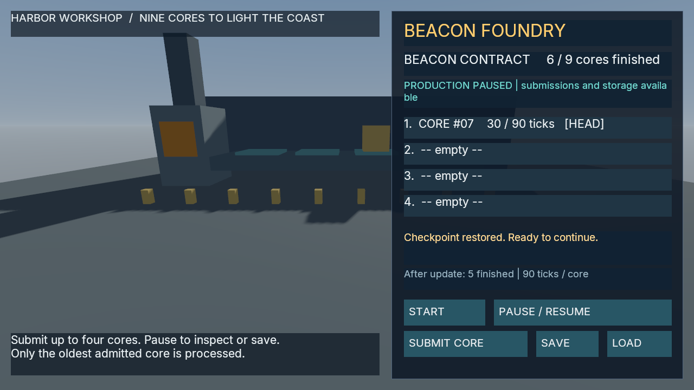

# Beacon Foundry

Beacon Foundry is a small 3D production-management game authored in one fresh Codex session. The original [V1](src/v1/Foundry.cs) and [V2](src/v2/Foundry.cs) C# files and shared [world](world.json) retain their exact bytes. [Provenance](provenance.json) identifies them and the original SDK-dependent project inputs.

The game admits up to four native work-unit entities into an authoritative FIFO collection. Only its head progresses, taking 90 unpaused callbacks per unit toward a goal of nine. Eligible Submit controls refuse immediately at capacity. Compiled Save/Load preserves real unfinished work, native identities, progress and logical UI. The V2 update adds one zero-default counter for subsequent completions while retaining all 12 original persistent fields by stable ID.

Independent source and relocated Windows readonly-service campaigns pass against the original artifacts. They check complete native checkpoint restoration before callbacks, an explicit identity-bound V1→V2 upgrade, warm and cold new-unit births/removals and final output 9/counter 8. The relocated campaign uses each game's declared bundled executable while three named original/source evaluation roots are unavailable, then restores them exactly. [Evidence and limits](../../m2-agent-beacon-foundry.json) distinguish these bounded results from broader engine qualification.

Three paused 1280×720 Vulkan captures show the initial game, restored output 6/counter 5 with core #7 at 30/90 ticks, and completed output 9/counter 8. All essential text is readable; the paused status wraps mid-word. Separate UI/capture frame IDs differ, so the evidence joins unchanged committed state rather than an atomic frame/layout pair.

This public record includes the original source and authored world. The original admitted SDK/toolchain and compiled artifacts are not included; building, adopting and exporting this public source selection has not been qualified. The input profile and original project hashes are recorded without distributing their reference environment. The sources and primitive world use the engine's [Apache-2.0 license](../../../../LICENSE).
