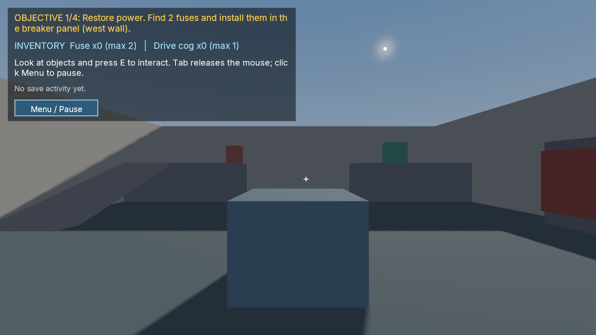

# Pump House: agent-authored repair adventure

A fresh Claude Code session authored [the original C# game](PumpHouseGame.cs)
from the frozen [task](TASK_v1.md) and general engine references. Collect two
fuses, power a shutter, recover a drive cog, raise a bridge and start the pump.
The [locator map](LOCATOR.json) describes identities and progression; it is not
the correctness oracle. [Provenance](provenance.json) preserves original hashes.

The original session completes native publication, adoption and Windows export
in about 14 minutes, using one publication and two exports. Six failed script
attempts remain recorded. A separate earlier run failed after a supervisor bug
interrupted it; its partial game was not reused.

Independent source and relocated-game campaigns pass 3,880 native calls. They
drive actual movement, camera rays, pickups and moving collision bodies, then
verify complete saved state before callbacks, cold Welcome Load, completion and
New Game preserving the previous checkpoint. The exported executable runs while
the original case is unavailable. [Results and limits](../../m2-agent-pumphouse.json).



The independent [partial checkpoint](partial.png) and [completed view](completed.png)
also join logical UI at the captured tick and revision. These are 1280×720 Vulkan
captures of a functional greybox. Text wraps within words, shadows are coarse,
and the latter views are close to geometry.

This is a source/evidence record, not a portable project or downloadable game
bundle. Relative paths in the original locator refer to the retained delivery;
rebuilding this source record has not been qualified. No new art, music or
models were acquired or generated. The game uses native box primitives.

The generated launcher omits save storage. The qualified service uses an existing
external `--save-root`; the documented interactive launch additionally requires
that argument. Interactive `game run`, physical devices, listening, clean-machine
installation and representative performance are separate checks.

With a complete bundle and an existing writable directory outside it, the
interactive command described by the original playtest is:

```text
poima game run GAME_JSON --save-root EXISTING_EXTERNAL_DIRECTORY --width 1280 --height 720
```

The [independent verifier](../../../../tests/agent_pumphouse_oracle.py) consumes an
explicit plan naming the engine, world or game, matching descriptor, fresh output
and external saves, input hashes/inventories, `seconds: 300` and capture selection.
Run it under the existing Windows [Job owner](../../../../tests/switchback_ownership.py),
which retains original streams and distinguishes natural closure from forced
cleanup. It never compiles, changes game source or patches gameplay state.
