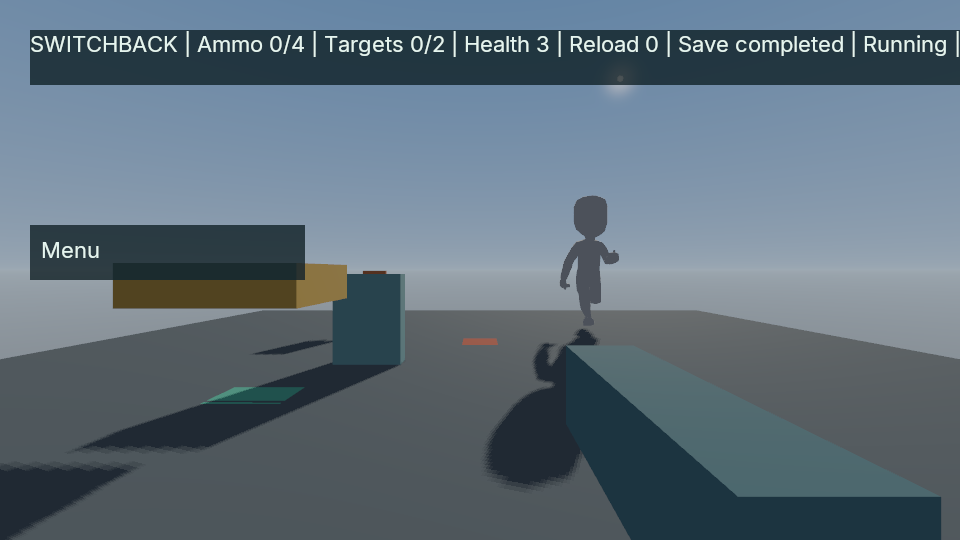

# Second fresh agent-authored Switchback game

An independent Codex session authored this game's [Range.cs](src/Range.cs) and [State.cs](src/State.cs) from the frozen Switchback exercise and generic engine references. Both files retain their original bytes. [Provenance](provenance.json) records their hashes; [exercise.json](exercise.json) maps the actual game/UI/imported-node identities for the [public verifier](../../../../tests/agent_switchback_oracle.py).

The original supervisor passes with 36 native invocations and 31 naturally closed script attempts, retaining nine failed attempts. Independent original-game and relocated readonly-service campaigns each pass thirteen groups, nine complete version-9 checkpoints and five typed-exact whole-checkpoint pairs. Separate Ready/Idle/Run Vulkan observations pass while the declared original project paths are unavailable, followed by exact restoration. [Evidence, versions and limits](../../m2-agent-switchback-fresh-repeat.json).

The Ready Begin/Load controls, active Menu and native Idle/Run poses are visible. The long HUD clips at the right edge at 960 pixels, and shadows remain coarse; this is a functional greybox demonstration.

Together with the [earlier fresh run](../agent-switchback-fresh/README.md), this supplies two bounded successful fresh contexts. Previous workflow failures remain failed. Updated Python client/docs and generic process-lifecycle guidance are disclosed in the evidence; this is not a controlled success-rate experiment or full Alpha qualification.

This is a source/evidence record, not a standalone portable project or redistributed game bundle. The original project references a separately supplied SDK bridge; rebuilding this source record has not been qualified. The shared [exercise rules](../agent-switchback-fresh/TASK.md) and [licensed-content notices](../agent-switchback-fresh/README.md) provide context.
