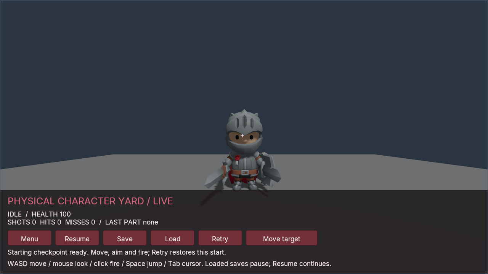
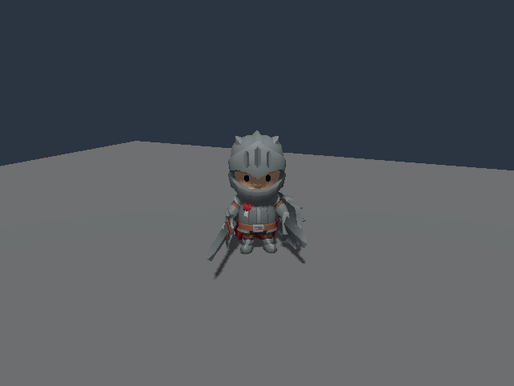
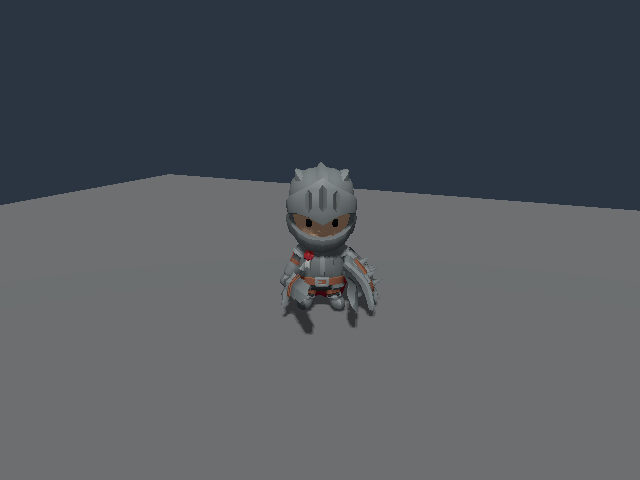

# Physical Character Yard

A reproducible full-body PhysicalRig specimen using the unchanged **KayKit
Adventurers 1.0 Knight**, by **Kay Lousberg**, licensed **CC0-1.0**. The example
contains a metric physics profile and original code; supply the artwork and its
original license separately.

## Play the sample

The compiled C# sample puts these systems into a first-person test yard. Move
and aim independently of the Knight, switch its original Idle/Running_A clips,
and fire a native camera ray. The returned hit region selects the physical body
that receives the impulse. A lethal hit transfers the current character pose to
passive physics. Save/Load preserves either state; Retry restores the separate
checkpoint created by Begin.



Actual Windows Vulkan idle capture. Knight artwork: Kay Lousberg, CC0-1.0.
This still shows the sample's appearance; it does not qualify motion quality.

Prepare with a simulation-enabled CLI and the original files listed below:

```sh
python examples/physical-character-yard/prepare.py \
  --binary /path/to/poima --source /path/to/Knight.glb \
  --license /path/to/LICENSE.txt --output build/physical-character-project
dotnet build examples/physical-character-yard/Poima.PhysicalCharacterGame.csproj \
  -c Release --artifacts-path build/physical-character-managed
```

Use a fresh project output. Preparation imports the complete library, binds
fifteen named hit regions to the observed original bones, and writes a project,
input profile and source-provenance receipt. It does not download artwork.
The game builds against the checkout's gameplay SDK by default; set
`PoimaGameplayAssembly` to an existing matching SDK DLL to use binary references.

On Windows, use **native Windows Python**, the Vulkan `poima.exe`, and matching
[CoreCLR authoring artifacts](../../docs/AUTHORING_TOOLS.md). For example, in
PowerShell with `$poima`, `$hostfxr` and `$bridge` pointing to those files:

```powershell
python examples/physical-character-yard/run.py `
  --binary $poima --project build/physical-character-project/project.json `
  --assembly build/physical-character-managed/bin/Poima.PhysicalCharacterGame/release/Poima.PhysicalCharacterGame.dll `
  --hostfxr $hostfxr --bridge $bridge --output build/physical-character-play
```

The launcher owns one shared service and its interactive player. Begin enters
play; WASD moves, mouse aims, Space jumps and left click fires. Tab releases the
cursor for the controls. Menu blocks gameplay pointer input; Resume continues.
Loading a checkpoint opens paused, so choose Resume afterward. Each launch has
its own save folder under its fresh output directory. Closing the window closes
the owned service. `--trace` optionally records bounded diagnostic RPC logs.

`Health`, `Damage`, `ShotImpulse`, `Range`, `PatrolExtent` and `RunInput` are typed,
inspectable gameplay tuning. All 61 mutable gameplay fields are serialized.
Native input owns the player's movement; C# owns only the target's patrol.
Shots run before target motor/animation edits to keep physical ownership
unambiguous. Named hit regions are authored query proxies, not exact skinned
mesh collision. Retry restores a checkpoint; it is not a get-up animation or
active balance system.

The public [gameplay check](../../tests/physical_character_gameplay_contract.py)
exercises ordinary controls, actual camera hits, zero/positive impulse response,
rejected-command rollback and complete warm/cold saves on Windows and Linux.
The separate [Windows player check](../../tests/physical_character_player_contract.py)
uses elapsed-time background play, native logical input and Vulkan captures.
Neither substitutes for physical mouse/controller testing or motion-quality
review. Run these checks under an external process-tree supervisor with fresh
output directories; both provide their input selectors through `--help`.

### Build a standalone Windows game

Use native Windows Python, a .NET 10 SDK and an x64 Visual Studio C++ developer
shell with the Windows SDK installed. `$dotnet` selects the installed .NET SDK's
`dotnet.exe`; `$poima` is the simulation-enabled Windows CLI. `$runtime` is a
matching installed Windows runtime directory containing `runtime.json`.
The exporting CLI and runtime must have the same exact engine version.

From this checkout, publish the same C# game using the public
[Native AOT publisher](../../docs/NATIVE_GAMEPLAY.md#publish):

```powershell
python scripts/publish_native_gameplay.py `
  --project examples/physical-character-yard/Poima.PhysicalCharacterGame.csproj `
  --type Poima.Examples.PhysicalCharacterGame --dotnet $dotnet --rid win-x64 `
  --output build/physical-character-aot --work build/physical-character-aot-work
```

Keep both output directories new. Publication requires the native compiler;
playing the resulting game does not require a .NET SDK or CoreCLR bridge.
An [installed authoring pack](../../docs/AUTHORING_TOOLS.md#create-a-game-project)
provides the alternative binary-SDK publication route.

Adopt the artifact into the prepared project with current file identities, then
export it to a fresh directory. Check each command succeeds before continuing:

```powershell
$project = 'build/physical-character-project/project.json'
$artifact = 'build/physical-character-aot/native-gameplay.json'
$request = 'build/physical-character-adopt.json'
& $poima project inspect $project
$adoption = @{
  request_id = [Guid]::NewGuid().ToString('N')
  expected_project_sha256 = (Get-FileHash $project -Algorithm SHA256).Hash.ToLowerInvariant()
  expected_artifact_sha256 = (Get-FileHash $artifact -Algorithm SHA256).Hash.ToLowerInvariant()
  values = @{}
} | ConvertTo-Json -Depth 4
[IO.File]::WriteAllText($request, $adoption, [Text.UTF8Encoding]::new($false))
& $poima project adopt-gameplay $project --artifact $artifact --request $request
& $poima project build $project --output build/physical-character-player --runtime $runtime
& $poima game inspect build/physical-character-player/game.json
& .\build\physical-character-player\launch.cmd
```

Move the complete exported directory to relocate the game. Keep reports and
added files outside its verified inventory. The Windows launcher stores saves
outside the bundle, under the current user's per-project Poima save directory;
see [standalone player options](../../docs/PROJECTS.md#run-or-replay).

The [checkpoint evidence](../../docs/evidence/m2-playable-physical-character.json)
records this sample's native library, 63-file Windows export and separate
277-RPC native / 287-RPC relocated gameplay checks. Both verify complete
animated/passive saves and fresh-process continuation. The relocated test used
the bundled engine with its owned export-source path unavailable; other
development files remained on the machine. These checks do not establish
clean-machine deployment or physical input quality. The player captures above
use CoreCLR and are a separate evidence scope. A separate relocated Native AOT
welcome capture also passed: three idle ticks, four presented Vulkan frames and
no reported GPU errors; it does not qualify normal-speed gameplay motion.

## Physical profile

The profile maps fifteen named bodies and fourteen joints to original model
nodes. Its total authored mass is 72 kg. The complete original library remains
intact: 57 nodes, 41 skin joints, 76 animation takes, 7,024 source vertices and
6,952 triangles. Capsules follow measured source segment directions; joint
constraint-X axes are calibrated separately from capsule-Y axes. Pelvis/chest
proxies use explicit source landmarks. Dimensions, masses and joint limits are
reviewable tuning values rather than claims of anatomical accuracy.

## Original inputs

Obtain the files from the [pinned official KayKit repository](https://github.com/KayKit-Game-Assets/KayKit-Character-Pack-Adventures-1.0/tree/672074b73ba276876a19e8816ecdc5241817ab47):

| Input | Repository path | Bytes | SHA-256 |
| --- | --- | --- | --- |
| Knight | `addons/kaykit_character_pack_adventures/Characters/gltf/Knight.glb` | 3,659,532 | `60428e3abc09ba83e595d256e3af8c5c976b46cdae599f0802fc82b4a3445168` |
| Original notice | `LICENSE.txt` | 891 | `ae322141814056dda0deea7540d74c41d87aee1da319977cd1bd84ee5a923629` |

`source-manifest.json` retains attribution and these identities. The source must
remain unchanged: no scale-channel stripping, geometry repair, converted
replacement, mesh generation or altered animation library is used.

## Calibration and source checks

These utilities run from a Poima source checkout and reuse the independent
original GLB/accessor/FK/LBS reader in `tests/character_library_intake.py`.
From the repository root:

```sh
python3 -B examples/physical-character-yard/knight_profile.py \
  --source /path/to/Knight.glb --license /path/to/LICENSE.txt \
  --output build/knight-calibration
python3 -B tests/physical_character_calibration.py
python3 -B tests/physical_character_source.py \
  --source /path/to/Knight.glb --license /path/to/LICENSE.txt
```

Use a fresh output directory. Calibration reproduces every byte of the selected
`profiles/knight.json`, reports original source influences and coverage, records
all 91 nonadjacent proxy pairs across five selected poses, and emits the complete
76-take summary. It does not create artwork or invoke the engine. The sixteen
analytic primitive-distance controls qualify the geometric audit math only.

The opt-in binding is `pose_frame: "skeletal_fixed_scale"`. Physical bodies use
logical quaternion chains and actual affine bone origins; authored COM offsets
stay in metres. Source local scales and ordinary TRS/FK remain intact. **Idle
(take 36)** and **Running_A (take 48)** are initialized in separate worlds. Their
scale channels are constant within each take but differ on 28 nodes. The test
does not switch or crossfade them, average a scale, or claim that every take
supports this binding. A one-ULP sampled scale change is a failure.

## Composing original clips

The strict profile above intentionally remains fixed-scale. For small original
scale differences in a shared playback world, make an explicit profile variant
with `pose_frame: "skeletal_bounded_scale"` and `max_scale_deviation: 0.00001`.
Keep its fifteen bodies, fourteen joints and source artwork unchanged.

That policy preserves actual per-tick source scales in animation and after
passive takeover. It does not normalize keys or resize physical proxies. The
bound applies to every final composed node, so source keys fitting the envelope
do not guarantee that every additive layer or inertial transition will fit.
Out-of-bound samples reject the complete batch. The
[physical-frame contract](../../docs/PHYSICAL_RIGS.md#bounded-source-scale-composition)
describes initialization, errors, exact saved-scale witnesses and ownership.
An explicit root-controller link is exercised by the
[movement-to-physics workflow](../../docs/CHARACTER_CONTROLLER_HANDOFF.md).
The grounded-foot ownership policy is exercised below. Active balance,
root-motion transfer and recovery remain separate work.

With simulation enabled in a matching 0.0.220 build, run the shared-world
workflow under an external process-tree supervisor:

```sh
python3 -B tests/physical_character_transitions.py /path/to/poima \
  --source /path/to/Knight.glb --license /path/to/LICENSE.txt \
  --output build/physical-character-transitions
```

The output must be new. This test preserves the complete original library,
crossfades Idle → Running_A → Death_B, transfers the last committed blended pose
to physics, and keeps original scale sampling active afterward. Each fresh
engine process opens the same world only after the preceding writer closes.
It retains literal requests/responses, 21 full node observations, fifteen
archives and eight complete archive comparisons. Every saved scale joins the
actual native node exactly. Independent source arithmetic allows four ULPs;
this is distinct from the authored relative envelope. The
[Linux result](../../docs/evidence/m2-bounded-skeletal-scales.json) and separate
[Windows result](../../docs/evidence/m2-bounded-skeletal-scales-windows.json)
qualify this selected sequence, not all animation combinations or visual motion
quality.

## Planted feet into passive physics

The [grounded handoff workflow](../../docs/GROUNDED_PHYSICAL_HANDOFF.md#original-knight-workflow)
combines the bounded-scale profile, a linked controller and
`procedural_pose: "grounded_animated_only"` on this unchanged character.
It pauses the original Idle clip, establishes two real planted-foot anchors on
a flat floor, and moves the actor about **5.33 mm** while those anchors stay
fixed. The corrected pose and its preceding completed sample then supply the
physical takeover, including each body's finite-difference velocity.

With a simulation-enabled build supporting that policy, run under an external
process-tree supervisor:

```sh
python3 -B tests/physical_character_grounded_handoff.py \
  --binary /path/to/poima \
  --source /path/to/Knight.glb --license /path/to/LICENSE.txt \
  --output build/physical-character-grounded
```

Use native Python and `poima.exe` on Windows, and a fresh output directory on
either platform. The test imports the complete original library, rejects an
activation/grounding-write conflict without changing the complete save, and
checks warm and fresh-process restore both before and after takeover. Continued
simulation must reproduce the complete saved bytes, including the historical
foot decisions; no state fields are excluded.

Separate [Linux and Windows CPU runs](../../docs/evidence/m2-character-grounded-handoff.json)
pass this workflow on the unchanged 0.0.228 native runtime, schema 127. Each
uses three naturally closed engine processes. The short paused-Idle movement
tests planted ownership and transfer; it does not qualify a walking gait,
active balance or natural-looking motion.

The [depth-reference procedure](../../docs/GROUNDED_PHYSICAL_HANDOFF.md#depth-reference-and-hardware-capture)
uses original geometry and these actual saved poses. Producing that reference
does not execute a renderer. Separate Windows Vulkan checks on an RTX 4070
Laptop GPU verify five Windows-saved poses and reproduce each complete image
after fresh-process restore. These 640×480 single-sample captures establish
selected still-frame depth and replay agreement, without qualifying
antialiasing, normal-speed motion or performance.

The original Linux-to-Windows generated-IK restore failure is addressed by the
0.0.230 [save reader](../../docs/GAMEPLAY_SAVES.md#grounded-save-compatibility).
[Qualified transfers](../../docs/evidence/m2-grounded-save-portability.json)
preserve the complete original saves in both directions. Recomputed physical
diagnostics and future simulation are not guaranteed bit-identical across
platforms; rendered qualification remains a separate scope.

## Native acceptance

Use an engine build exposing `PhysicalRig.pose_frame = "skeletal_fixed_scale"`.
An external process-tree supervisor must own and bound the following test:

```sh
python3 -B tests/physical_character_native.py /path/to/poima \
  --source /path/to/Knight.glb --license /path/to/LICENSE.txt \
  --output build/physical-character-native
```

The test imports the original asset and independently compares every triangle
corner, skin influence, inverse bind and original curve array. Each take has
its own world: Idle uses stairs, Running_A uses a slope. A translated/rotated
wrapper exercises actual frame composition. The original base animation plays
for six ticks before passive takeover. All 57 published node poses and strict
local scales are checked against original source FK. Complete saved final-pose
history independently verifies each mapped COM and linear/angular finite
velocity; aggregate post-solver linear momentum accounts for fixed gravity and
drag without pretending individual velocities are unchanged by constraints.

It then applies an offset shoulder hit, observes a fall, performs same-owner
warm restore and fresh-process cold restore, and compares each immediate and
future **complete archive byte sequence** without field exclusions. Settling
and a later waking hit have fixed bounds. The final settling chunk is observed.
Literal requests, responses, complete saves, imported packages, failures and
CLI process closure are retained. No compiler, renderer or download is launched
by this test. The external supervisor separately proves descendant ownership.

## Limits and quality review

The profile is provisional. Original-source inspection records head/upper-arm
overlaps around 25.9 mm at rest and 8–10.4 mm during selected Idle poses. Selected
Running_A poses also have chest/forearm and pelvis/shin overlap. Every pair is
reported; internal contact is not hidden by extra exclusions. Zero overlap in
every authored animation is not a universal acceptance condition. Meaningful
core proxies, actual contact behavior and visible quality must inform tuning;
vertex coverage alone does not establish a good collision proxy.

`neutral_rotation: identity` refers to the original rest/T-pose joint frame.
Nonzero rest stiffness can bias a fallen body toward that pose. Relaxed neutrals
need explicit authoring and hard-limit validation; hinge-axis projection or an
out-of-limit candidate must not become an undocumented clamp.

The [Linux qualification](../../docs/evidence/m2-skeletal-physical-rigs.json) and
[Windows qualification](../../docs/evidence/m2-skeletal-physical-rigs-windows.json)
each pass both original-take workflows, with four naturally closed engine
processes, eighteen archives and eight complete warm/cold archive comparisons.
Separate [Windows Vulkan observations](../../docs/evidence/m2-skeletal-physical-rigs-rendering.json)
include eight isolated original right-arm diagnostics and three complete
original-material character views. Four whole-BMP pairs match after warm/cold
restoration and continued simulation. The arm diagnostics retain all original
nodes and bodies, but do not test every drawable's pixels. Visual review shows
the Knight falling onto the steps and settling; still images and source
geometry/math do not establish motion quality. Shared-world crossfades and
root-controller handoff now have the separate selected evidence linked above.
Production contact/motion, hands/feet/accessories, active balance, stand-up
recovery and representative performance remain open. The playable sample's
selected Native AOT workflow is qualified separately above. The linked
actor's root-only graph and root-motion/IK restrictions follow the
[ownership contract](../../docs/PHYSICAL_RIGS.md#controller-handoff). The analytic
ribbon continues to provide a separate clean skin/projection oracle.

## Grounded capture examples

These actual Vulkan stills show the original CC0 Knight at the planted boundary
and an early passive pose. They use the single-sample geometry-verification
settings described above; they are not a motion-quality demonstration.

| Planted boundary | After physical takeover |
| --- | --- |
|  |  |
