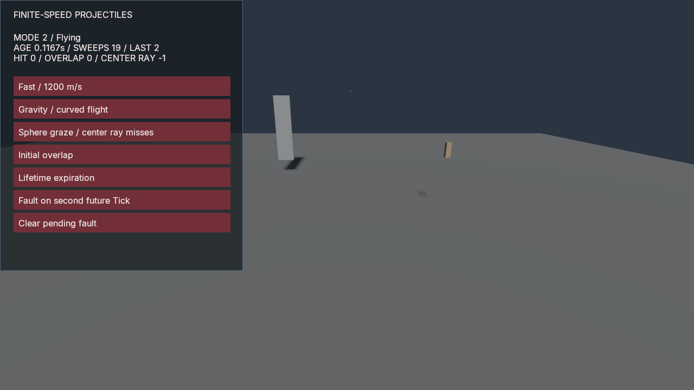

# Projectile Range

A small compiled consumer of [Projectiles.cs](../../packages/fps/Projectiles.cs).
One saved sphere projectile uses native `capsule_cast_v1` queries, including a
1,200 m/s thin-wall case, constant gravity, a sphere graze missed by its center
ray, an initial overlap, and exact lifetime expiration. Geometry is ordinary
procedural boxes; no downloaded or generated art is needed.

Flight position, incident velocity, age, phase, query counts and full contact
diagnostics are primitive gameplay fields. The helper records are transient.
Native contact points are observations: the projectile stops at the swept
**chord center**, rather than moving its center to a surface contact point.
The rendered marker is a separate kinematic body20, explicitly excluded from
every query. Its staged movement remains invisible to this Tick's queries. The
marker follows at no more than90m/s, below the native100m/s kinematic limit; it
can trail far behind a fast projectile. Saved flight state and cast results are
the authoritative trajectory, not this deliberately bounded visualization.

Prepare a new manifest and byte-identical public input profile, then author the
world through the native service. Preparation alone deliberately creates no
world; run configure before inspection or gameplay adoption:

```sh
python examples/projectile-range/prepare.py --output build/projectile-project
python examples/projectile-range/configure.py --binary <poima> --project build/projectile-project/project.json --output build/projectile-configure
```

Configure requires an untouched new project and creates the camera/controller,
floor, two collision targets, marker and controls in one guarded transaction.
It preserves its original requests, responses, stdio and native close result.
It neither compiles gameplay nor changes the historical input-profile source.

Build with .NET10/C#14 and a matched gameplay SDK, CoreCLR bridge and hostfxr:

```sh
dotnet build examples/projectile-range/Poima.ProjectileRangeGame.csproj -c Release -o <sample-build> -p:PoimaGameplayAssembly=<Poima.Gameplay.dll>
python examples/projectile-range/run.py --binary <poima> --project build/projectile-project/project.json --assembly <sample-build>/Poima.ProjectileRangeGame.dll --bridge <Poima.ManagedBridge.dll> --hostfxr <hostfxr> --output build/projectile-play --gpu 0
```

Omit `PoimaGameplayAssembly` to build against the source SDK instead. The module
declares `ICapsuleCastGame`; it needs the independently negotiated400-byte host
services prefix, not a new ABI. Windows uses native Windows Python and Windows
paths. Interactive rendering needs a matching native Windows Vulkan build.
The bounded player defaults to600 frames and120s request timeout; unattended
execution needs an enclosing process-tree owner. It configures no automatic
saves and performs no export or AOT publication.

The Fast/Gravity/Graze/Overlap/Expire buttons queue a replacement launch for the
next Tick. Normal speed is fixed at60Hz by the runtime. Each active Tick makes
at most eight sphere sweeps, within the host's shared32-attempt callback budget.
All projectiles share this native per-Tick budget with any other capsule queries.
`QueryCount` is cumulative; `LastQueries` covers only the most recent Tick.
Impact and expiration retain the final state and contact without another cast.
Gravity may eventually hit the floor; lifetime expiration uses a clear path.

The Fault button schedules an intentional exception on the second future sample
Tick, after updating flight state, staging marker movement and updating UI. It
exists for complete native batch-rollback checks. Clear pending fault before
continuing normal play. There is no claim that a helper alone rolls back physics
or external query-provider side effects.

The gravity path is approximated conservatively: every linear sweep adds its
quadratic chord-error envelope to the physical radius and rounds that radius
outward for native float conversion. This can stop early. An inflated-query
initial overlap is not proof that the physical sphere overlaps. Native contact
tolerances still apply; this is not exact parabolic time of impact or relative
CCD against moving targets. Penetration, ricochet, drag, wind, pooling, damage,
weapon firing policy and representative performance remain separate work.

Changing the persisted flight definition during continuation is an explicit
gameplay edit, not an implicit save migration. Native AOT, standalone export, physical interaction and fresh-agent authoring
remain separate qualification scopes.



*Greybox range at a saved gravity-flight checkpoint. The bounded marker trails
the authoritative projectile position; this is a captured frame, not a recording
of physical input or a production rendering-quality demonstration.*

[Qualification](../../docs/evidence/m2-projectiles.json) records the executed
Linux/Windows CoreCLR workflows and separate Windows Vulkan captures.
