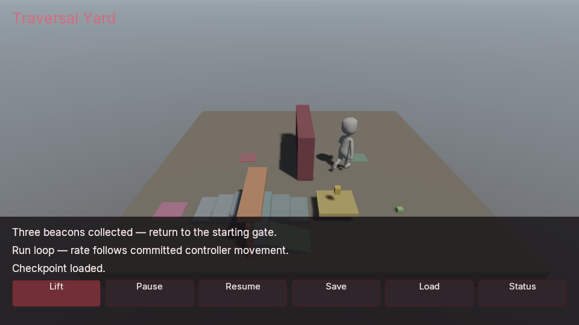

# Traversal Yard

A first-person C# sample built from native character locomotion, crouch, named
actions, camera lenses and durable saves. Climb three steps, crouch under the
lintel, ride the lift, collect three beacons and return to the starting gate.
A separate imported courier demonstrates code-driven Idle/Run playback while
the player explores. The courier owns its own capsule and has no player camera.

The Windows **0.0.127** contract completed the course on CoreCLR and Native AOT
using public semantic inputs through the compiled game. Each backend passed
five check groups with two native owners and nine selected version-9 snapshots:
**702 RPCs** on CoreCLR and **708 RPCs** on Native AOT. Four complete snapshot
pairs matched on both backends; Native AOT also preserved exact state after a
denied module replacement. CoreCLR compatible reload changed only the gameplay
revision and its snapshot digest. Continuation compares two cold-restored owners.



*Captured after collecting the three beacons, using the independent overview
camera. The playable camera is first-person.*

The Native AOT run produced three **960×540**, **4× MSAA** captures on
**AMD Radeon(TM) Graphics**: starting and returned first-person views, and the
collected-course overview. They use the authored procedural sky, a
shadow-enabled directional Sun and fractional nine-tap PCF. These are scripted
gameplay and readback checks, without a measured AA or shadow-quality claim. Physical input feel,
game-scale performance and a completed Alpha are separate acceptance work.

## Content and compilation

Use Python 3.9+, a .NET 10 SDK, and a matching engine with simulation, navigation
and game UI. Windows graphical play also needs Vulkan. CoreCLR development needs
the matching managed bridge and hostfxr. Native AOT uses the native gameplay
backend instead; see [managed gameplay](../../docs/MANAGED_GAMEPLAY.md) and
[native gameplay](../../docs/NATIVE_GAMEPLAY.md).

Supply the unchanged Kenney **Animated Characters Protagonists 1.1** files used
by [Locomotion Yard](../locomotion-yard/README.md#prerequisites-and-original-content):
`Model/characterMedium.fbx`, `Animations/idle.fbx`, `Animations/run.fbx` and
`License.txt`. The launcher checks their existing SHA-256 profile, performs no
downloads, retains the CC0 attribution, and reuses the inspected reference-pose
rotation retargeting policy. The original Locomotion Yard remains unchanged.

From the repository root:

```text
dotnet build examples/traversal-yard/Poima.TraversalYardGame.csproj -c Release -m:1 --artifacts-path build/traversal-yard/dotnet-artifacts -o build/traversal-yard/managed
dotnet run --project managed/Poima.NativeGame.Generator -c Release -- --components build/traversal-yard/managed/Poima.TraversalYardGame.dll build/traversal-yard/game.poima-components.json
```

The module is `Poima.Examples.TraversalYardGame`, with identity
`poima.examples.traversal-yard`. It mirrors the two existing component schemas:
`LocomotionVisualConfig` (`bbbbbbbbbbbbbbbbbbbbbbbbbbbbbb75`) and
`LocomotionRoute` (`bbbbbbbbbbbbbbbbbbbbbbbbbbbbbb76`). Their field IDs, typed
defaults and fixed-capacity route buffer remain the same. Import the generated
manifest from this assembly; copying a manifest from another module does not
prove the new compiled artifact's schema identity.

The module requires services epoch **7**, the **336-byte** prefix, and
`baseline_v7`, `component_collections_v1`, `animation_inertial_v1`,
`character_input_v1`, `navigation_query_v1`, `input_actions_v1`,
`camera_lens_v1` and `character_stance_v1`. Load negotiation checks these features
before construction. No new gameplay ABI is introduced by this sample.

## Play

With Windows-native Python, use a fresh output directory:

```powershell
python examples/traversal-yard/run.py `
  --binary build/windows-runtime/bin/poima.exe `
  --source-directory build/locomotion-source `
  --manifest build/traversal-yard/game.poima-components.json `
  --assembly build/traversal-yard/managed/Poima.TraversalYardGame.dll `
  --hostfxr "C:/Program Files/dotnet/host/fxr/10.0.12/hostfxr.dll" `
  --bridge managed/Poima.ManagedBridge/bin/Release/net10.0/Poima.ManagedBridge.dll `
  --output build/traversal-yard/play-01
```

Replace hostfxr with your installed matching runtime and retain the bridge's SDK
and runtime configuration files. From WSL, add `--windows-interop` and supply
WSL-accessible paths. `--gpu` selects a discovered device. For a published native
artifact, replace `--assembly`, `--hostfxr` and `--bridge` with `--descriptor`,
and use that publication's component manifest.

| Control | Result |
| --- | --- |
| WASD / mouse | Move and look through the native player controller. |
| Space | Jump. |
| Hold C | Request crouch. Releasing C requests standing; a low ceiling delays expansion. |
| Hold right mouse button (`mouse.3`, SDL numbering) | Aim: ease the world camera from its authored FOV to 45 degrees. |
| E | Pick up a nearby beacon; near the lift, request its next trip. |
| Tab | Release the pointer for the HUD. |
| Lift | Request a trip from either end, including when the platform is out of reach. |
| Pause / Resume | Pause or resume native playback and compiled decisions. |
| Save / Load / Status | Request or inspect the durable `traversal-yard` checkpoint. |

The launcher owns the actual physical bindings. There is no separate named lift
binding that duplicates E. A busy lift ignores a new trip request. It completes
its current **90-tick** native kinematic motion before another can start.

Player **100** starts at `(-8, .1, 6)` facing +X; camera **101** is its child.
The staircase leads to a low lintel. Beacon **210** requires the player to be
actually crouched and grounded on the **0.6 m** landing, inside the lintel's
`x(-3.2,-2.2), z(5,9)` footprint, when E is pressed within **1.25 m**. Beacon **211** requires
grounded feet above **1.2 m** inside the raised lift, rather than proximity from
the floor. Beacon **212** is beyond the lift. Once all three are collected and
the lift has been activated, return within **1.25 m** of gate **213** to finish.
The immutable beacon markers stay in the world; the HUD records collection.

The launcher selects 4× MSAA and the existing fractional nine-tap PCF shadow
filter. Direct captures use the same recipe. The exported `game run` CLI retains
its default point-sampled PCF filter; those recipes have separate scope. The sky
is an artistic background; constant ambient fill is separate. Neither provides
GI or environment reflections.

Only native physics moves the player and lift. C# does not teleport the player,
rewrite authored transforms during play, or replace the runtime to complete the
course. Stance commands persist requested intent, while the getter reports the
committed effective capsule and blocked standing state.

## Fixed-Tick state and saves

Aim transitions take **12 fixed ticks** using
[`CameraFovTransition`](../../docs/CAMERA_LENSES.md). Start, target, elapsed ticks
and current FOV are primitive saved game fields. Reversing aim retargets from the
committed lens; this preserves FOV position, without promising velocity
continuity. Rendering and inspection do not advance that gameplay transition.
The sample changes only the world lens, retaining its clip planes.

Checkpoint requests use native save tickets. The HUD distinguishes accepted
requests from completed saves or loads; Status can poll a pending result while
paused. The external save store preserves the full native world, player stance,
lift motion, beacon progress, aim phase, courier route and animation clocks.
Loading reconciles the destination save epoch and the actual completion receipt.
Compatible CoreCLR reload retains primitive game state; Native AOT replacement
requires a new process.

Courier **300** and rig **400** reuse the original courier navigation and
inertial-animation policy. Run rate is derived from consecutive committed
horizontal positions, not desired input velocity. Idle continues while stopped;
rate-only corrections wait for an active transition to finish. This is neither
automatic body crouch animation nor stride fitting, foot locking or root-motion
locomotion. Navigation serves the courier's original flat route around the
cover. The player traverses the new course through character input; the sample
does not promise navigation across the moving lift or dynamic navigation baking.

## Verification and export

Use the separate [traversal contract](../../tests/traversal_yard_contract.py)
with supplied compiled artifacts and original sources to exercise actual caller
input, course progress, native save receipts and fresh-process continuation.
Its `--prepared-world` mode consumes an existing cooked world instead of
`--source-directory`, runs the same course and save checks, and performs no FBX
inspection or import. The launcher also accepts `--prepared-world` to copy and
reopen that cooked world under a fresh owned path.

Follow [project export](../../docs/PROJECTS.md#install-a-runtime-and-export) for
Native AOT publication and relocated runtime bundles. Keep mutable saves outside
the immutable bundle and retain the Kenney attribution in the cooked closure.
The Windows Native AOT export passed after relocation outside the checkout,
with its original owned authoring paths absent and a restricted executable
search path. The exported player presented 1,401 frames over 1,400 replay ticks
on the RTX 4070 Laptop GPU. A separate cooked-world run completed the course
through semantic inputs: 525 RPCs, nine selected durable snapshots and five
exact complete-state pairs. It exercised the real Save/Load UI and cold-owner
continuation. The 62-file bundle stayed unchanged, retaining cooked content,
native gameplay, the runtime, dependency notices and Kenney credits.

Reproduce with a matching installed, stripped runtime and published artifact:

```powershell
python tests/traversal_yard_bundle.py `
  --binary build/runtime-windows/bin/poima.exe `
  --runtime build/runtime-windows `
  --artifact build/traversal-yard/native/native-gameplay.json `
  --source-directory build/locomotion-source `
  --output build/traversal-yard/export-check-01 `
  --ticks 1400 --capture --gpu 0 --timeout 900
```

Select your discovered GPU and use a new output directory. The fixture performs
no compilation or downloads. It retains its authoring copy and relocated bundle,
including on failure. Four 960×540 NVIDIA readbacks cover the player replay and
the three cooked-course checkpoints; all use 4× MSAA, with the separately
documented PCF recipes. [Qualification results](../../docs/evidence/m2-traversal-yard.json).

Scripted gameplay, image readbacks and relocation are separate scopes. They do
not qualify physical input, controller comfort, frame rate, general characters
or a complete FPS.
