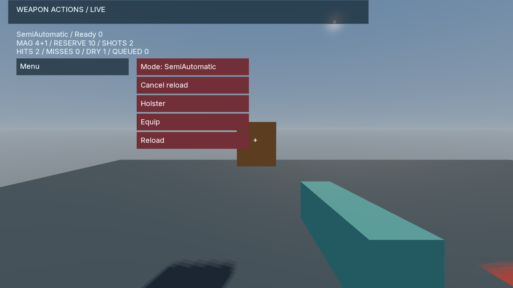

# Weapon Actions Range

A compiled C# consumer of the optional [FPS weapon actions](../../docs/WEAPON_ACTIONS.md)
package. It uses the existing licensed FPS scene, with an independent project,
game identity and 33 primitive saved fields. Original scene notices remain in
its copied content.

The sample separates magazine, chamber and reserve; supports semi-automatic,
automatic and three-round burst fire; and exposes reload cancellation,
holster/equip and pause controls. Accepted `Shot` events alone perform native
hit tests and recoil impulses. Hit tests use the native base camera plus saved
logical recoil; camera presentation and foreground kick remain independent.



*Native observation with a full magazine and a retained chambered round.*

The scene's existing character/animation serves as a stationary target. This
sample concentrates on weapon actions; it does not implement attachments,
an inventory interface, weapon animations or a general weapon asset catalog.

Prepare and configure a fresh project with native platform Python:

```sh
python examples/weapon-actions/prepare.py --output build/weapon-actions-project
python examples/weapon-actions/configure.py --binary <poima> --project build/weapon-actions-project/project.json --output build/weapon-actions-configure
```

Build the gameplay module with .NET 10 and a compatible Poima gameplay SDK:

```sh
dotnet build examples/weapon-actions/Poima.WeaponActionsGame.csproj -c Release -o <sample-build> -p:PoimaGameplayAssembly=<Poima.Gameplay.dll>
```

Launch the prebuilt module using a matching CoreCLR bridge and platform hostfxr.
Windows requires native Windows Python and Windows paths:

```sh
python examples/weapon-actions/run.py --binary <poima> --project build/weapon-actions-project/project.json --assembly <sample-build>/Poima.WeaponActionsGame.dll --bridge <Poima.ManagedBridge.dll> --hostfxr <hostfxr> --output build/weapon-actions-play --gpu 0
```

Begin in the UI. WASD/mouse move and look, C crouches, right mouse aims,
left mouse fires and R reloads. Menu pauses; Resume continues. Mode changes
are accepted when no burst is outstanding. Cancel, Holster, Equip and Reload
buttons queue actions for the next active tick. Paused controls retain their
queue without advancing weapon timers. Holster wins if commands are combined.
The interactive script creates no build or automatic save configuration.

The CPU verifier consumes prebuilt artifacts and opens no renderer:

```sh
python tests/weapon_actions_gameplay_contract.py <poima> --assembly <sample-build>/Poima.WeaponActionsGame.dll --bridge <Poima.ManagedBridge.dll> --hostfxr <hostfxr> --output <fresh-proof-directory>
```

Run it under an external process-tree owner. It preserves literal native RPCs
and complete checkpoint payloads, tests ammo conservation and reload-stage
interruption, checks an actual target hit despite misleading presentation,
and compares full rollback and same/fresh-process continuation bytes.
`--native-descriptor` is a separate consumer route; it does not establish Native
AOT qualification without an actual run.

The [checkpoint evidence](../../docs/evidence/m2-weapon-actions.json) records
CoreCLR checks on Windows and Linux with the 0.0.209 native runtime, plus two
saved-state NVIDIA Vulkan observations. Each platform passes 204 RPCs and four
complete checkpoint-byte pairs; the visual checks separately preserve state
across capture. These are controlled sample checks, not physical-input or
production rendering qualification.
